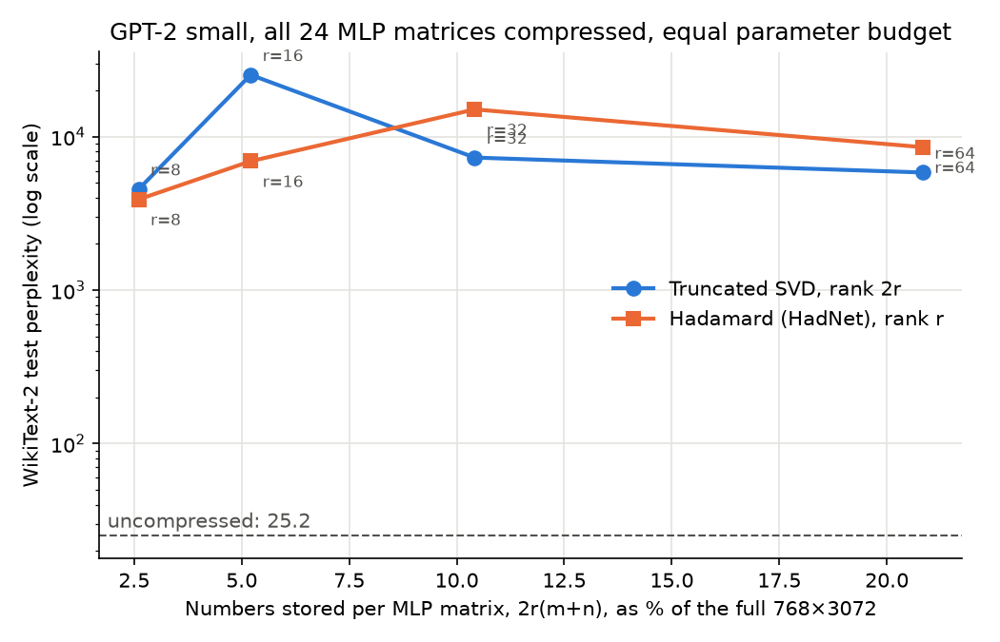
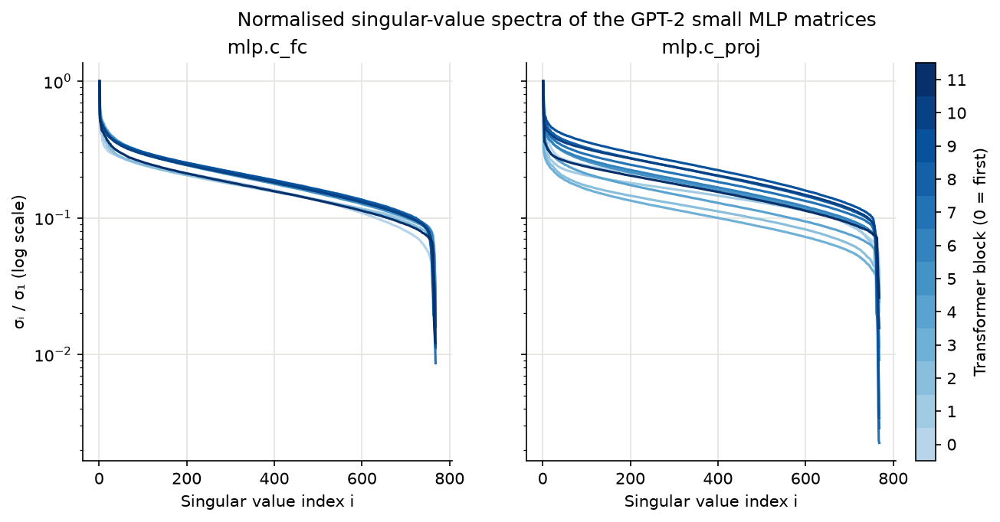
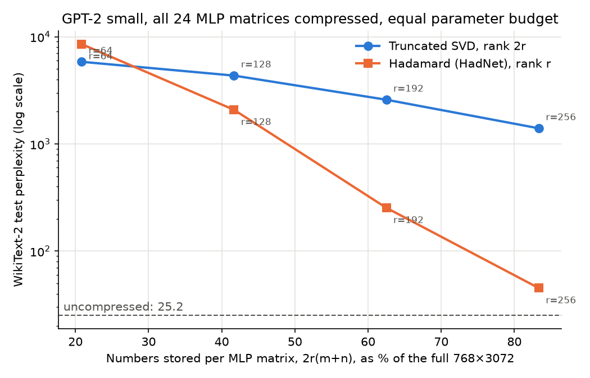
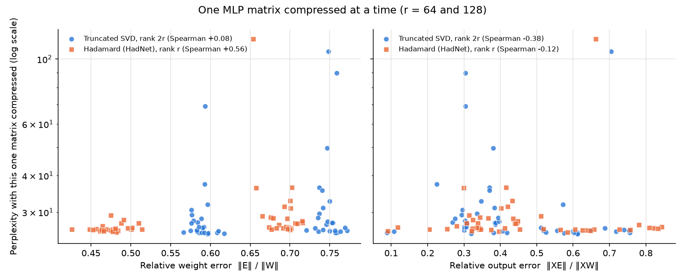

# Hadamard decomposition vs. truncated SVD on GPT-2 small

A small, fully traceable experiment on the method of Panchal, Sahoo and Behera, [*Tensor decomposition and neural architectures through generalized Hadamard products*](https://doi.org/10.1016/j.neucom.2026.134372), Neurocomputing 699 (2026) 134372.

It compresses the MLP weight matrices of GPT-2 small with the paper's Hadamard decomposition (HadNet) and with truncated SVD **at the same number of stored parameters**, and measures WikiText-2 perplexity.

This is an independent study project. It is not affiliated with the paper's authors. Every function is traced to the paper or to public code in [`VERIFICATION.md`](VERIFICATION.md).

## What the experiment tests

GPT-2 small has 12 transformer blocks. Each block's MLP has two weight matrices, `c_fc` (3072×768) and `c_proj` (768×3072), 24 matrices in all. We replace every one of them by a compressed version and measure how much the language model degrades, using WikiText-2 test perplexity (lower is better).

Two compression methods are compared. Write (m, n) for the matrix shape.

1. **Truncated SVD at rank 2r.** W ≈ U Σ Vᵀ with the top 2r singular values kept. By the Eckart–Young theorem this is the best possible approximation of rank 2r.
2. **Hadamard decomposition at rank r.** W ≈ (W1 H1) ∘ (W2 H2), where ∘ is the entrywise product, W1 and W2 are (m, r), H1 and H2 are (r, n). The factors are fitted with HadNet (paper §4.1, Algorithm 7), started from the SVD initialisation (paper §3.3).

### Why the fair baseline is SVD at rank 2r

The Hadamard factors hold 2·r·m + 2·r·n = 2r(m+n) numbers. A rank-k SVD, stored as U_kΣ_k and V_kᵀ, holds k(m+n). The two are equal when k = 2r. The paper's tables compare Hadamard at rank r with SVD at rank r, which gives the Hadamard side twice the storage. Here both methods get exactly the same number of stored numbers (`checks.py`, check 5).

The interest of the Hadamard form is that its result can have rank up to r² (paper Prop. 3.3), far above 2r, for the same storage. Whether that helps depends on the matrix: it can only help if the singular values between positions 2r+1 and r² carry real weight (paper Prop. 3.5).

### What is and is not measured

After fitting, the dense matrix is rebuilt from the factors and copied back into the model. This measures **storage compression only**. The model runs exactly as fast as before, and nothing is fine-tuned afterwards.

## Maths behind the checks

`checks.py` tests these four facts numerically. They are short enough to derive here.

**M1. Khatri–Rao identity (why the rank can reach r²).** Expand one entry of the Hadamard product:

```
[(W1 H1) ∘ (W2 H2)]_ij = (Σ_k W1_ik H1_kj) (Σ_l W2_il H2_lj)
                       = Σ_{k,l} (W1_ik W2_il) (H1_kj H2_lj)
                       = Σ_{k,l} E_{i,(k,l)} F_{(k,l),j}
```

So (W1 H1) ∘ (W2 H2) = E F, where E (m, r²) has rows `W1[i] ⊗ W2[i]` (row-wise Khatri–Rao product) and F (r², n) has columns `H1[:, j] ⊗ H2[:, j]` (column-wise Khatri–Rao product). A product with inner dimension r² has rank at most r². This is the paper's Prop. 3.3.

**M2. Eckart–Young error formula.** If X has singular values σ₁ ≥ σ₂ ≥ …, its rank-k truncated SVD X_k is the best rank-k approximation in Frobenius norm, and ‖X − X_k‖_F² = Σ_{i>k} σᵢ². The paper uses this as its Theorem 3.1 (summed over tensor slices).

**M3. Parameter count.** Hadamard at rank r stores four factors: 2·(m·r) + 2·(r·n) = 2r(m+n). SVD at rank k stores U_kΣ_k (m, k) and V_kᵀ (k, n): k(m+n). Equal at k = 2r.

**M4. How much Hadamard can gain over SVD (paper Prop. 3.5).** Let  be the best Hadamard approximation at rank r. By M1 it has rank ≤ r², so by M2 it cannot beat the rank-r² SVD: ‖A − Â‖² ≥ Σ_{i>r²} σᵢ². Subtracting from the rank-2r SVD error Σ_{i>2r} σᵢ² gives

```
‖A − A_2r‖² − ‖A − Â‖²  ≤  Σ_{i=2r+1}^{r²} σᵢ²
```

The possible gain is the energy in singular values 2r+1 … r². It is large for a flat spectrum and small for a fast-decaying one. It is only an upper bound: the actual gain can be smaller, or negative. Check 6 shows both cases.

## How to run it

Needs Python 3.12 and, for reasonable speed, a CUDA GPU (about 6 GB is enough).

```
python -m venv .venv
source .venv/bin/activate
pip install -r requirements.txt

python checks.py          # 8 correctness checks, a few seconds, must end with "All checks passed."
python compress_gpt2.py   # main experiment, r = 8..64     -> results.csv, spectra.npz
python diagnostics.py     # diagnostics, r = 64..256       -> diagnostics.csv
python plot.py            # figures                        -> *.png
```

GPT-2 small and WikiText-2 are downloaded from the Hugging Face Hub on first use. They are not part of this repository.

On the laptop GPU used for the results below (RTX 4050), `compress_gpt2.py` takes about 11 minutes: about 3 s per HadNet fit (96 fits) and about 35 s per perplexity evaluation (9 evaluations). `diagnostics.py` takes about 75 minutes; it makes 104 perplexity evaluations.

To change ranks, methods or layers, edit the constants at the top of `compress_gpt2.py` or `diagnostics.py`. There are no command-line options.

## What each file does

| File | Purpose |
|---|---|
| `hadamard.py` | The maths on one matrix: `svd_init`, `hadnet_fit`, `reconstruct`, `svd_truncate`. |
| `checks.py` | Eight correctness checks (Khatri–Rao identity, rank bound, exact SVD init, Eckart–Young, parameter count, spectrum dependence, output-error identity, Spearman). |
| `compress_gpt2.py` | Loads GPT-2 small, compresses the 24 MLP matrices for each method and rank, measures perplexity, writes `results.csv` and `spectra.npz`. |
| `diagnostics.py` | Bug check, gentler budgets, output-error and entrywise-error measurements; writes `diagnostics.csv` See "Diagnostics" below. |
| `plot.py` | Draws `perplexity.png` and `spectra.png`, and from `diagnostics.csv` also `perplexity_gentle.png` and `error_vs_perplexity.png`. |
| `VERIFICATION.md` | One row per function: where it comes from (paper section or URL) and how it differs from the source. |
| `requirements.txt` | torch, transformers, datasets, numpy, matplotlib, with the versions used. |
| `results.csv` | Output of `compress_gpt2.py`. One row per compressed matrix (method, r, layer, matrix, stored numbers, relative Frobenius error, fit time) with the run's perplexity repeated on each row; plus one baseline row. |
| `diagnostics.csv` | Output of `diagnostics.py`. One row per compressed matrix: weight error, output error, entrywise statistics, perplexity with that matrix alone compressed (r = 64, 128), perplexity with all 24 compressed. |
| `spectra.npz` | Output of `compress_gpt2.py`. Singular values of the 24 **original** matrices, keys `h0_c_fc` … `h11_c_proj`. |

## Results: main experiment (r = 8 to 64)

One run, 15 November 2026, RTX 4050 laptop GPU, Python 3.12, torch 2.15.0, transformers 5.23.0, float32. Nothing in the pipeline is random, so there is no seed-to-seed spread to report. All numbers below are read from `results.csv`.

Uncompressed GPT-2 small: perplexity **25.17** (window 1024, stride 512).

| r | Stored share of each matrix | SVD rank 2r: perplexity | Hadamard rank r: perplexity | Lower perplexity | SVD: mean rel. error | Hadamard: mean rel. error |
|---|---|---|---|---|---|---|
| 8 | 2.6% | 4,546 | 3,904 | Hadamard | 0.9320 | 0.9275 |
| 16 | 5.2% | 25,286 | 6,922 | Hadamard | 0.8978 | 0.8870 |
| 32 | 10.4% | 7,310 | 15,063 | SVD | 0.8419 | 0.8157 |
| 64 | 20.8% | 5,843 | 8,547 | SVD | 0.7480 | 0.6906 |

"Mean rel. error" is ‖W − Ŵ‖_F / ‖W‖_F averaged over the 24 matrices.





### What the numbers say

1. **Both methods break the model at every budget tested.** The best compressed perplexity is 3,904 against 25.17 uncompressed. For scale, guessing uniformly over GPT-2's 50,257 tokens gives perplexity 50,257. Even at r = 64 the weight error is 69–75% of the matrix norm.
2. **On perplexity the two methods split 2–2, and neither curve is monotone.** Hadamard is lower at r = 8 and r = 16; SVD is lower at r = 32 and r = 64. SVD gets worse from r = 8 to r = 16 and Hadamard gets worse from r = 8 to r = 32, although their weight errors fall steadily. With models this damaged, the perplexity ordering should not be read as a ranking of the methods.
3. **On weight error Hadamard wins almost everywhere, and by more as r grows.** It has the lower Frobenius error on 85 of the 96 (matrix, r) pairs: 15/24 at r = 8, 22/24 at r = 16, 24/24 at r = 32 and at r = 64. The 11 losses are all `c_fc` matrices at r = 8 (9) and r = 16 (2). The mean gap grows from 0.005 at r = 8 to 0.057 at r = 64.
4. **A lower weight error did not give a lower perplexity.** At r = 32 and r = 64 Hadamard has the lower error on all 24 matrices and the worse perplexity. With only `h[0].mlp.c_fc` compressed at r = 16, Hadamard had relative error 0.884 against 0.907 for SVD, and perplexity 49,851 against 5,733.
5. **The spectra are flat, which is the regime where the Hadamard form is expected to win on weight error.** After a sharp drop over the first few singular values, σᵢ/σ₁ stays between about 0.07 and 0.4 across almost all of the 768 values. The top 128 singular values hold only 41–46% of the squared norm in the six matrices inspected (blocks 0, 5, 11). This matches item 3 and `checks.py` check 6.

## Diagnostics

The main experiment left a puzzle: Hadamard had the lower weight error but often the worse perplexity. `diagnostics.py` measures three possible explanations. It changes nothing about how either method is fitted.

| | Hypothesis | What is measured |
|---|---|---|
| H3 | **Bug.** The weight in the model is not the one that was fitted (transpose, copy, dtype, device). | Near the break-even rank (r = 300; SVD at rank 600) one matrix is written into the model, read back, and its error compared with the error before writing. Perplexity with only that matrix replaced should stay close to 25.17. |
| H1 | **Error direction.** The network feels the output error ‖X(W − Ŵ)‖ on real inputs X, not the weight error ‖W − Ŵ‖. | Relative output error ‖XE‖_F / ‖XW‖_F with E = W − Ŵ, computed from the Gram matrix G = XᵀX of each layer's inputs on 64 × 512 tokens of the WikiText-2 **train** split. Compared with weight error as a predictor of perplexity when one matrix is compressed at a time. |
| H2 | **Outlier entries.** The Hadamard reconstruction has heavier-tailed entrywise errors. | max \|E\|, the 99.9th percentile of \|E\|, and the largest column norm of E over the median column norm. |

It also repeats the comparison at gentler budgets: each of the 24 matrices compressed alone at r = 64 and 128, and all 24 together at r = 64, 128, 192 and 256 (21% to 83% of each matrix stored).

All numbers below are from one run of `diagnostics.py` (15 November 2026, same machine and versions as above) and are read from `diagnostics.csv`.

### Short answer

- **H3 (bug): refuted.** The model holds exactly the fitted weights.
- **H1 (error direction): not supported as stated.** Relative output error is a worse predictor of single-matrix perplexity than weight error, and its rank correlation with perplexity is negative.
- **H2 (outlier entries): refuted.** Hadamard's entrywise errors are smaller and more evenly spread than SVD's at every budget where it loses.
- **The puzzle is specific to small budgets.** From r = 128 upwards, with all 24 matrices compressed, Hadamard is clearly better, and the gap widens to 45 against 1,399 at r = 256.

### H3: bug check

Only the named matrix is replaced. Uncompressed perplexity is 25.17.

| Matrix | Method | Rank | Weight error before writing | Weight error read back | Perplexity |
|---|---|---|---|---|---|
| `h[0].mlp.c_fc` | SVD | 600 | 0.211221 | 0.211221 | 26.28 |
| `h[0].mlp.c_fc` | Hadamard | 300 | 0.079341 | 0.079341 | 25.08 |
| `h[5].mlp.c_fc` | SVD | 600 | 0.222180 | 0.222180 | 25.61 |
| `h[5].mlp.c_fc` | Hadamard | 300 | 0.050389 | 0.050389 | 25.34 |

The errors agree, the layer's output equals `x @ W_hat + bias` for the fitted matrix, and the original weight is restored exactly. No bug was found. Near break-even, Hadamard has both the lower weight error and the perplexity closer to the baseline.

### Gentler budgets, all 24 matrices compressed

| r | Stored share | SVD rank 2r: perplexity | Hadamard rank r: perplexity | SVD: mean weight error | Hadamard: mean weight error | SVD: mean output error | Hadamard: mean output error |
|---|---|---|---|---|---|---|---|
| 64 | 20.8% | 5,843 | 8,547 | 0.748 | 0.691 | 0.489 | 0.529 |
| 128 | 41.7% | 4,343 | 2,083 | 0.589 | 0.477 | 0.390 | 0.403 |
| 192 | 62.5% | 2,586 | 253 | 0.449 | 0.291 | 0.305 | 0.269 |
| 256 | 83.3% | 1,399 | 45.2 | 0.318 | 0.185 | 0.225 | 0.186 |



Hadamard loses at r = 64 and wins at r = 128, 192 and 256, by a factor of 2, 10 and 31. At 83% of the storage, SVD still gives perplexity 1,399; Hadamard gives 45.2 against 25.17 uncompressed. Even here neither method is close to lossless when all 24 matrices are compressed.

### One matrix compressed at a time (r = 64 and 128)

The ten most damaging single-matrix runs, out of 96 (the full table is in `diagnostics.csv`, column `perplexity_single`):

| Matrix | Method | r | Stored share | Weight error | Output error | Perplexity |
|---|---|---|---|---|---|---|
| `h[0].c_proj` | Hadamard | 64 | 20.8% | 0.654 | 0.663 | 117.1 |
| `h[0].c_proj` | SVD | 64 | 20.8% | 0.748 | 0.704 | 106.4 |
| `h[0].c_fc` | SVD | 64 | 20.8% | 0.759 | 0.305 | 89.7 |
| `h[1].c_fc` | SVD | 128 | 41.7% | 0.594 | 0.304 | 69.0 |
| `h[1].c_fc` | SVD | 64 | 20.8% | 0.747 | 0.380 | 49.6 |
| `h[0].c_fc` | SVD | 128 | 41.7% | 0.593 | 0.225 | 37.4 |
| `h[4].c_fc` | SVD | 64 | 20.8% | 0.737 | 0.370 | 36.5 |
| `h[5].c_fc` | Hadamard | 64 | 20.8% | 0.702 | 0.416 | 36.4 |
| `h[0].c_fc` | Hadamard | 64 | 20.8% | 0.658 | 0.300 | 36.3 |
| `h[5].c_fc` | SVD | 64 | 20.8% | 0.740 | 0.370 | 35.6 |

- **Damage is concentrated in the first two blocks.** `h[0].c_proj`, `h[0].c_fc` and `h[1].c_fc` account for the six worst runs. The median over all 96 runs is 26.5, and only 17 runs exceed 30.
- **`c_fc` matrices are more sensitive than `c_proj`.** Outside block 0, every `c_proj` run stays below 29.1.
- **Hadamard is better on `c_fc`, SVD on `c_proj`.** Hadamard has the lower perplexity on 7 of 12 `c_fc` matrices at r = 64 and 11 of 12 at r = 128, but on only 1 and 2 of 12 `c_proj` matrices. Overall it wins 8 of 24 at r = 64 and 13 of 24 at r = 128. Most `c_proj` differences are small (under 1 perplexity point outside blocks 0 and 1).
- **SVD on `h[1].c_fc` is not monotone:** perplexity 49.6 at r = 64 and 69.0 at r = 128, although the weight and output errors both fall.

### H1: which error measure predicts the damage?



Spearman rank correlation with log perplexity over the 48 single-matrix runs of each method:

| Method | Weight error | Output error |
|---|---|---|
| SVD | +0.08 | −0.38 |
| Hadamard | +0.56 | −0.12 |

Neither measure predicts the damage well, and output error is the worse of the two: its correlation is negative for both methods. The reason is visible in the tables above. Most `c_proj` matrices have large relative output errors (above 0.5 on 10 of 12 for SVD at r = 64) and almost no effect on perplexity, while `c_fc` matrices have smaller output errors (0.30 to 0.45 at r = 64) and larger effects. Splitting by matrix type removes the negative sign but does not put output error ahead: within `c_fc` the correlations are +0.32 (weight) and +0.02 (output) for SVD, +0.50 and +0.35 for Hadamard; within `c_proj`, +0.34 and +0.31 for SVD, +0.58 and +0.43 for Hadamard.

A second, paired test asks whether, on the same matrix and r, the method with the lower error also has the lower perplexity. Hadamard has the lower weight error in all 48 pairs, so weight error predicts the winner only when Hadamard wins: 21 of 48. Output error predicts the winner in 31 of 48 (17 of 24 at r = 64, 14 of 24 at r = 128). It does well on `c_proj` (21 of 24) and poorly on `c_fc` (10 of 24): at r = 128 Hadamard has the higher output error on 10 of 12 `c_fc` matrices and the lower perplexity on 11 of 12.

What does hold: Hadamard's advantage in weight error shrinks or reverses when measured on real activations. At r = 64 and r = 128 it has the lower weight error on all 24 matrices but the lower output error on only 5. At r = 192 it has the lower output error on 23 of 24. So the error-direction effect is real, but output error measured one layer at a time does not explain the perplexity ordering.

### H2: entrywise errors

Means over the 24 matrices:

| r | max \|E\|: SVD | max \|E\|: Hadamard | 99.9th pct of \|E\|: SVD | 99.9th pct: Hadamard | Column-norm ratio: SVD | Column-norm ratio: Hadamard |
|---|---|---|---|---|---|---|
| 64 | 2.20 | 0.75 | 0.338 | 0.304 | 1.42 | 1.18 |
| 128 | 1.84 | 0.57 | 0.262 | 0.216 | 1.38 | 1.23 |
| 192 | 1.59 | 0.49 | 0.200 | 0.142 | 1.54 | 1.36 |
| 256 | 1.35 | 0.82 | 0.146 | 0.105 | 1.84 | 2.51 |

At r = 64, where Hadamard loses, its largest error entry is smaller than SVD's on all 24 matrices, its 99.9th percentile is smaller on all 24, and its column-norm ratio is smaller on 21. The only place Hadamard's errors are less even is r = 256 (column-norm ratio larger on 13 of 24 matrices, up to 6.6), and there its perplexity is 31 times better than SVD's. H2 is refuted.

At r = 256 there is one matrix, `h[0].c_proj`, where HadNet has the higher weight error (0.384 against 0.316). It is the only such case among the 96 fits at these four ranks.

### What remains unexplained

Why Hadamard is worse at small budgets (r ≤ 64) with all matrices compressed is still open. It is not a bug, not outlier entries, and not captured by per-layer output error. Two things these measurements do not cover are how errors in different layers compound when all 24 are compressed together, and the effect of the nonlinearity between `c_fc` and `c_proj`.

## Limits

- The loss fitted is plain weight error ‖W − Ŵ‖_F. Nothing here is activation-aware, and nothing is fine-tuned after compression.
- Only the MLP matrices are compressed; attention and embedding weights are untouched.
- HadNet used the paper's settings unchanged (Adam, learning rate 0.1, 2000 epochs, ×0.1 after 100 epochs without improvement). They were not tuned for these matrices.
- `hadnet_fit` returns the best factors seen, whereas the paper's Algorithm 7 and code return the last ones (see `VERIFICATION.md`, note 1).
- One model, one dataset, one run.

## Sources and acknowledgements

- **The method.** A. Panchal, J. K. Sahoo, R. Behera, *Tensor decomposition and neural architectures through generalized Hadamard products*, Neurocomputing 699 (2026) 134372, <https://doi.org/10.1016/j.neucom.2026.134372>. Their code: <https://github.com/PanchalAneesh/HadNet-HadDNN>. `hadamard.py` is a re-implementation of the single-matrix case, written from the paper and checked against that code; no file is copied from it.
- **Perplexity evaluation.** Hugging Face guide "Perplexity of fixed-length models", <https://huggingface.co/docs/transformers/perplexity>.
- **Calibration activations and the output-error measure.** SVD-LLM (X. Wang, Y. Zheng, Z. Wan, M. Zhang, ICLR 2025, <https://openreview.net/forum?id=LNYIUouhdt>, code <https://github.com/AIoT-MLSys-Lab/SVD-LLM>) and ASVD (Z. Yuan et al., <https://arxiv.org/abs/2312.05821>).
- **Model and data.** GPT-2 small (`gpt2`) and WikiText-2 (`Salesforce/wikitext`, `wikitext-2-raw-v1`), both loaded from the Hugging Face Hub.

If you use this repository, please cite the paper above.
