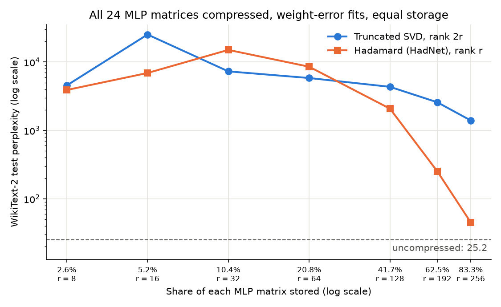
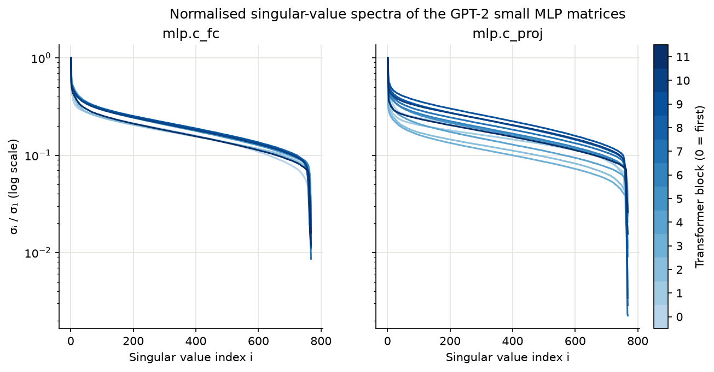
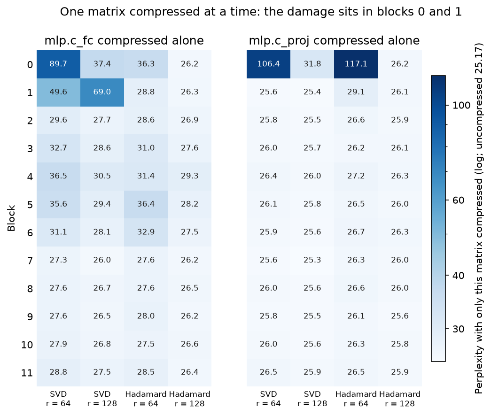
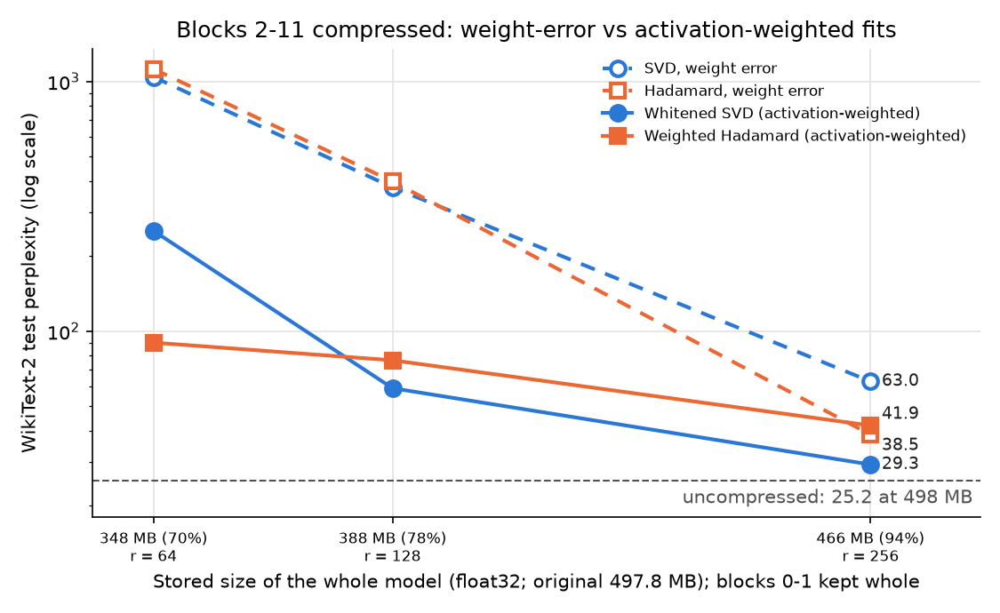
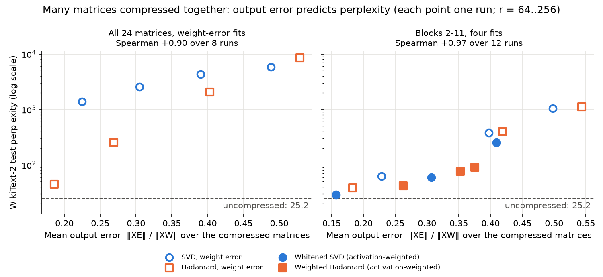
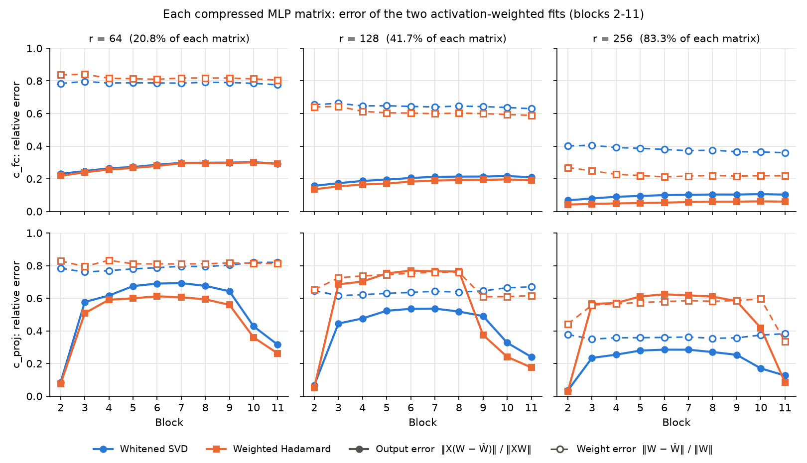
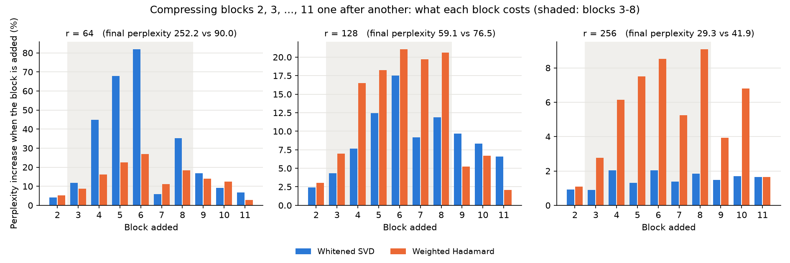

# Results

All numbers are WikiText-2 test perplexity of GPT-2 small (lower is better; uncompressed **25.17**), read from the CSV files in `results/`. Nothing in the pipeline is random, so each number comes from one deterministic run (RTX 4050, Python 3.12, torch 2.15.0, transformers 5.23.0, float32). Hadamard is always at rank r and SVD at rank 2r, so both store the same 2r(m+n) numbers per compressed matrix.

**In short:** with plain weight-error fits, Hadamard beats SVD once the budget is not tiny. But the biggest improvement comes from fitting the error on real activations instead: whitened SVD then reaches 29.3 with blocks 2–11 compressed, and weighted Hadamard wins at the smallest budget but is held back by its optimiser at larger ones.

## 1. Benchmark: weight-error fits, all 24 MLP matrices

`experiments/compress_gpt2.py` (r = 8–64) and `experiments/diagnostics.py` (r = 64–256; r = 64 is identical in both).

| r | Share of each matrix stored | SVD | Hadamard | SVD weight error | Hadamard weight error |
|---|---|---|---|---|---|
| 8 | 2.6% | 4,546 | 3,904 | 0.932 | 0.928 |
| 16 | 5.2% | 25,286 | 6,922 | 0.898 | 0.887 |
| 32 | 10.4% | 7,310 | 15,063 | 0.842 | 0.816 |
| 64 | 20.8% | 5,843 | 8,547 | 0.748 | 0.691 |
| 128 | 41.7% | 4,343 | 2,083 | 0.589 | 0.477 |
| 192 | 62.5% | 2,586 | 253.4 | 0.449 | 0.291 |
| 256 | 83.3% | 1,399 | 45.2 | 0.318 | 0.185 |

Weight error is ‖W − Ŵ‖_F / ‖W‖_F, averaged over the 24 matrices.

1. **Hadamard has the lower weight error almost everywhere** (on 85 of 96 matrix fits at r ≤ 64, and on all but one at larger r). This is expected: GPT-2's MLP spectra are flat (across the 24 matrices, the top 128 singular values hold only 40–48% of the energy), and that is where the Hadamard form's rank of up to r² pays off (README, M4).
2. **From r = 128 up, Hadamard also gives far better models:** 45.2 against 1,399 at 83% of each matrix stored.
3. **Up to r = 64 every model is broken** (perplexity in the thousands), the curves are not monotone, and Hadamard loses at r = 32 and 64 despite its lower weight error on every matrix. This mismatch is what the diagnostics investigate.

## 2. Diagnostics

`experiments/diagnostics.py`.

- **No bug.** One matrix fitted near break-even (r = 300) and written into the model reads back with exactly the fitted error, the layer computes x·Ŵ + b, and perplexity stays near 25.17 (25.08–26.28; printed by `diagnostics.py`, not saved to a CSV).
- **No outlier entries.** Where Hadamard loses (r = 64), its largest error entry is smaller than SVD's on all 24 matrices (mean 0.75 against 2.20).
- **A few matrices do most of the damage.** Compressing one matrix at a time (r = 64 and 128, 96 runs), the median perplexity is 26.5, but the six worst runs (37–117) are all block 0's `c_fc` or `c_proj` or block 1's `c_fc`.
- **Neither weight error nor output error predicts single-matrix damage** (Spearman correlation with perplexity +0.08 and −0.38 for SVD, +0.56 and −0.12 for Hadamard). Which matrix is compressed matters more than how large its error is. `c_proj` matrices have large relative output errors yet barely affect perplexity.

Output error is ‖X(W − Ŵ)‖_F / ‖XW‖_F on calibration inputs X: the layer's real inputs on 32,768 tokens of the WikiText-2 training split, kept as the Gram matrix XᵀX.

## 3. Activation-aware fits, blocks 0 and 1 kept whole

`experiments/activation_aware.py`. Two changes, both suggested by the diagnostics:

1. **Blocks 0 and 1 are not compressed.** Only the 20 MLP matrices of blocks 2–11 are.
2. **The methods are also fitted to output error** instead of weight error. For SVD this is SVD-LLM's whitened SVD, the exact optimum: with SSᵀ = G = XᵀX, truncate SᵀW to rank 2r and map back with (Sᵀ)⁻¹. For Hadamard it is HadNet with the loss √trace(Eᵀ G E) and everything else as in the paper; this weighted loss is this project's extension, not part of the paper. G is damped by 1% of its mean diagonal (as GPTQ does).

Keeping blocks 0 and 1 costs storage: the share of all MLP weights stored is 34.0%, 51.4% and 86.1% at r = 64, 128 and 256.

| r | MLP stored | SVD | Hadamard | Whitened SVD | Weighted Hadamard |
|---|---|---|---|---|---|
| 64 | 34.0% | 1,042 | 1,122 | 252.2 | **90.0** |
| 128 | 51.4% | 376.7 | 398.0 | **59.1** | 76.5 |
| 256 | 86.1% | 63.0 | 38.5 | **29.3** | 41.9 |

Mean output error of the same runs:

| r | SVD | Hadamard | Whitened SVD | Weighted Hadamard |
|---|---|---|---|---|
| 64 | 0.498 | 0.543 | 0.409 | 0.375 |
| 128 | 0.397 | 0.419 | 0.307 | 0.353 |
| 256 | 0.228 | 0.183 | 0.157 | 0.263 |

1. **Fitting output error is the largest effect, at equal storage:** 2–6× better for SVD, and 5–12× for Hadamard at r ≤ 128.
2. **With many matrices compressed together, output error predicts perplexity.** Across runs, mean output error and perplexity have Spearman correlation +0.97 (the 12 runs here) and +0.90 (the 8 all-24 runs of section 1), unlike the single-matrix case of section 2. Weight error does not: the weighted fits have the highest weight errors.

3. **Weighted Hadamard wins at r = 64; whitened SVD wins at r = 128 and 256.**
4. **Weighted Hadamard's losses are an optimiser failure on `c_proj`.** On every `c_fc` matrix it has a lower output error than whitened SVD. On `c_proj` in blocks 3–8 at r ≥ 128 its output error stays within 0.05 of its weight error (0.57–0.77), and at r = 256 it ends worse than plain HadNet on its own objective (0.471 against 0.247 on `c_proj`), so it has not converged. HadNet's settings (start, learning rate 0.1, 2000 steps) are the paper's, which were designed for weight error, not for this loss.

## 4. How the damage accumulates

`experiments/cumulative.py` compresses blocks 2, 3, …, 11 one after another with the two activation-weighted methods and measures perplexity after each block. Each sequence ends exactly on the matching run above.

| Blocks compressed | Whitened SVD, r = 64 | Weighted Hadamard, r = 64 | Whitened SVD, r = 128 | Weighted Hadamard, r = 128 | Whitened SVD, r = 256 | Weighted Hadamard, r = 256 |
|---|---|---|---|---|---|---|
| none | 25.17 | 25.17 | 25.17 | 25.17 | 25.17 | 25.17 |
| 2 | 26.22 | 26.47 | 25.78 | 25.93 | 25.40 | 25.44 |
| 2–3 | 29.33 | 28.77 | 26.89 | 27.75 | 25.63 | 26.15 |
| 2–4 | 42.47 | 33.40 | 28.95 | 32.32 | 26.15 | 27.75 |
| 2–5 | 71.27 | 40.92 | 32.55 | 38.21 | 26.49 | 29.83 |
| 2–6 | 129.60 | 51.96 | 38.25 | 46.25 | 27.03 | 32.37 |
| 2–7 | 137.26 | 57.80 | 41.75 | 55.36 | 27.40 | 34.08 |
| 2–8 | 185.50 | 68.38 | 46.70 | 66.77 | 27.90 | 37.17 |
| 2–9 | 216.81 | 77.87 | 51.24 | 70.25 | 28.32 | 38.63 |
| 2–10 | 236.48 | 87.53 | 55.49 | 74.95 | 28.79 | 41.25 |
| 2–11 | 252.21 | 90.04 | 59.14 | 76.51 | 29.27 | 41.93 |

1. **Each block multiplies perplexity** (by 1.009 to 1.82). At r ≤ 128, blocks 3–8 cause 70–85% of the total increase in log perplexity; block 2 and blocks 9–11 are cheap.
2. **A block's cost follows the output error of its `c_proj`** (Spearman +0.78 over all 60 steps; +0.60 for `c_fc`).
3. **At r = 256, whitened SVD costs under 2% perplexity per block**, with no jump anywhere.

## 5. Model size

Only the 24 MLP weight matrices (45.5% of GPT-2 small's 124.4M parameters, 497.8 MB in float32) are compressed. Size depends only on r and on how many matrices are compressed, not on the method (`src/methods.py`, `model_megabytes`). These are stored sizes: the experiments rebuild the dense matrices, so speed and memory while running are unchanged.

| Setting | r | Stored size | Of original | Best perplexity |
|---|---|---|---|---|
| Uncompressed | – | 497.8 MB | 100% | 25.17 |
| All 24, weight-error fit | 8 | 277.2 MB | 55.7% | 3,904 |
| All 24, weight-error fit | 256 | 460.0 MB | 92.4% | 45.2 (Hadamard) |
| Blocks 2–11, activation-weighted fit | 64 | 348.3 MB | 70.0% | 90.0 (weighted Hadamard) |
| Blocks 2–11, activation-weighted fit | 128 | 387.7 MB | 77.9% | 59.1 (whitened SVD) |
| Blocks 2–11, activation-weighted fit | 256 | 466.3 MB | 93.7% | 29.3 (whitened SVD) |

Savings are modest: no run halves the model and stays usable, because more than half of the model is never compressed. The best usable result saves 6.3% (29.3 at 466 MB).

## 6. Conclusions and next steps

- **The Hadamard form is a better approximation of GPT-2's weights than SVD at equal storage**, as its flat spectra predict, and with plain fits it gives far better models from r = 128 up.
- **What decides model quality is the loss being fitted.** Fitting output error on real activations helps far more than switching methods.
- **Whitened SVD is currently best except at the smallest budget.** Weighted Hadamard's results at r ≥ 128 understate what the Hadamard form can do: they are limited by the optimiser on `c_proj`.
- **Damage concentrates in a few places:** blocks 0–1, and the `c_proj` matrices of blocks 3–8.

Next: start the weighted HadNet fit from the plain HadNet or whitened-SVD solution (or lower its learning rate); use weighted Hadamard on `c_fc` and whitened SVD on `c_proj`; give blocks 3–8 more storage than blocks 2 and 9–11; recompute calibration inputs from the partly compressed model; add a short fine-tune.
