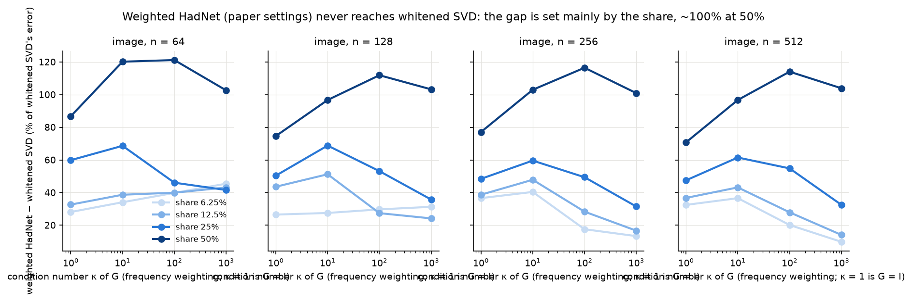
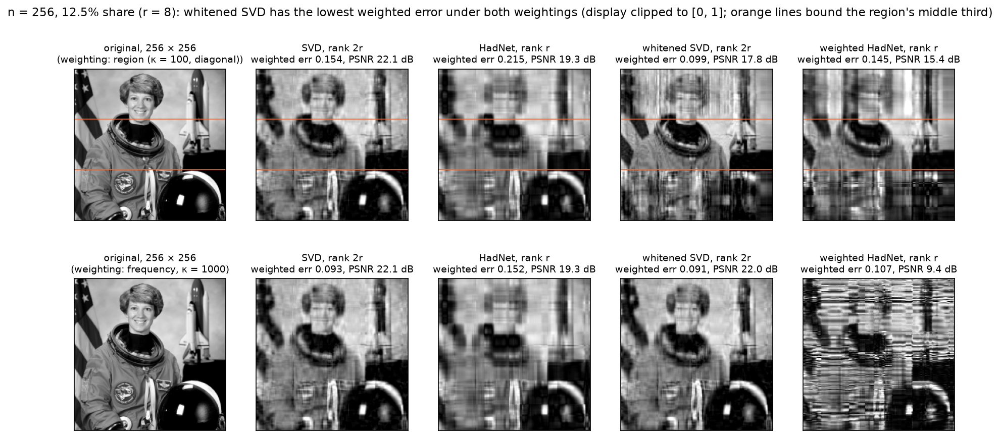
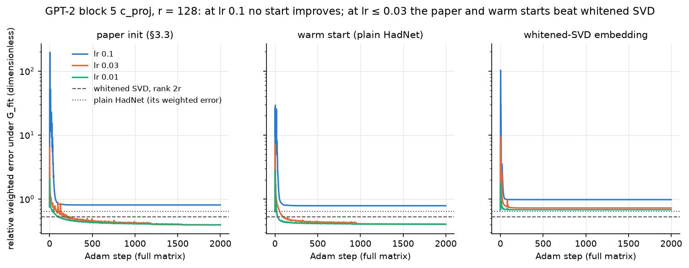

# Weighted Hadamard decomposition on single matrices (v2)

An independent study of Panchal, Sahoo and Behera, *Tensor decomposition and neural architectures through generalized Hadamard products*, Neurocomputing 699 (2026) 134372 ("the paper"). Every number below is read from a CSV in `results/`; section 9 gives the commands that produce them, and the appendix spot-checks 12 of them.

## 1. Summary

On a natural image (the astronaut photograph, 64 × 64 to 512 × 512), truncated SVD at rank 2r beats the paper's Hadamard decomposition (HadNet) at rank r **at equal storage, at every size and every storage share tested**. For example, at n = 256 and 12.5% storage the relative errors are 0.148 against 0.205. This is what Prop 3.5 predicts for a steep spectrum: the bound on HadNet's possible gain holds everywhere, and the actual gain is negative everywhere. On a flat-spectrum Gaussian control the result reverses: HadNet wins at every share, by up to 0.611 against 0.417. Under a weighted error, whitened SVD (SVD-LLM) has the lowest weighted error of all four methods in all 80 image cases. Weighted HadNet at the paper's settings trails it by 10% to 121%. The gap is set mainly by the storage share (about 100% at 50% share), and at small shares it shrinks as the weighting's condition number κ grows. v1's failure signature (weighted HadNet ending worse on the weighted loss than plain HadNet) appears in only 1 of 64 non-identity cases, and not at the worst condition numbers. On the image, the start and the learning rate barely matter: all six paper and warm-start configurations end at 1.55–1.56× whitened SVD's error. The specified whitened-SVD embedding never moves off its start, because its unused factor slots get zero gradient. On GPT-2's block 5 `c_proj` (r = 128), v1's numbers are reproduced exactly, and the picture is different. At the paper's learning rate 0.1, weighted HadNet never improves on any start, so v1's weighted HadNet result is simply the error of its starting point. At learning rate 0.03 or 0.01 it reaches a weighted error of 0.388–0.400, **24–26% below whitened SVD's 0.523**.

## 2. The problem

**Data.** A ∈ ℝ^{m×n}: a grayscale image with pixel values in [0, 1] (m = n), a Gaussian control, or a GPT-2 weight matrix.

**Hadamard decomposition** (paper Eq. 5, one slice): Â = (W₁H₁) ∘ (W₂H₂), with W₁, W₂ ∈ ℝ^{m×r}, H₁, H₂ ∈ ℝ^{r×n} and ∘ the entrywise product. It stores 2r(m+n) numbers and has rank at most r² (paper Prop 3.3). Truncated SVD at rank k stores k(m+n), so **equal storage means SVD at rank 2r**. The paper's tables compare at equal rank r, so SVD(r) is also reported as a reference.

**Weighted error.** For G = SSᵀ ∈ ℝ^{m×m} positive definite, acting on the **row** index:

  ‖Sᵀ(A − Â)‖_F = √tr(Eᵀ G E),  E = A − Â.

G = I gives the Frobenius error. Relative weighted error is ‖Sᵀ(A − Â)‖_F / ‖SᵀA‖_F. For GPT-2 in its native (in, out) layout, G = XᵀX on the layer inputs X makes this the layer's output error on those inputs (SVD-LLM Eq. 1; trace identity SVD-LLM Lemma 3.1).

**The four methods** (`src/hadamard.py`):

| Method | Storage | Fits to | How | Source |
|---|---|---|---|---|
| SVD | rank 2r | plain error | `svd_truncate` | Eckart–Young; paper Theorem 3.1 (one slice) |
| HadNet | rank r | plain error | `hadnet_fit`: Adam on the four factors, loss ‖A − Â‖_F (unsquared), lr 0.1, 2000 full-matrix steps, lr × 0.1 after 100 steps without a new best, best factors returned; start `svd_init` | Paper Algorithm 7, §3.3 (initialisation), §5 (η = 0.1, wait = 100, max_epochs = 2000); repo `random-tensor/main.py` lines 36–60 and 89–125 (commit 4aabe3d) |
| Whitened SVD | rank 2r | weighted error, exact optimum | `whitened_svd`: Â = (Sᵀ)⁻¹[SᵀA]₂ᵣ, S from `eigh(G)` | SVD-LLM (Wang et al., ICLR 2025, arXiv:2403.07378) §3.1, Theorem 3.2, Corollary 3.3 (Eq. 6); code `SVDLLM.py` lines 219–224 (commit 7538cca) |
| Weighted HadNet | rank r | weighted error | `hadnet_fit(..., G=G)`: Algorithm 7 with loss √tr(EᵀGE) | **This project's extension** |

Whitened SVD is optimal within rank-2r matrices. It is **not** a bound for the Hadamard family, which contains matrices of rank up to r².

**Weightings** (`src/weights.py`), all normalised to mean(diag G) = 1:

| Name | G | Condition number |
|---|---|---|
| identity | I | 1 |
| region | D², d_i = 10 on rows ⌊n/3⌋ … ⌊2n/3⌋ − 1, else 1 | 100 |
| freq κ | Cᵀ diag(w) C, C = `scipy.fft.dct(np.eye(n), norm="ortho", axis=0)`, w_k = κ^(−k/(n−1)) | κ ∈ {10, 100, 1000} |

The freq weighting makes errors in smooth vertical content cost up to κ times more than errors in fine vertical detail. `results/conditions.csv` lists every G's condition number. They match the targets to 10⁻¹³ relative (check 12).

**Image and metrics.** `skimage.data.astronaut()` (public-domain NASA photograph) is converted with `rgb2gray` and resized with anti-aliasing to n ∈ {64, 128, 256, 512}. Storage shares 4r/n ∈ {6.25, 12.5, 25, 50}% give r = n/64, n/32, n/16, n/8. The control is a 256 × 256 standard Gaussian matrix (seed 42). Each fit reports relative plain error, relative weighted error, fit time and, for HadNet, the step count, best step and full loss curve (`results/curves_*.npz`). PSNR = 10·log₁₀(1/MSE) in dB, with pixels on [0, 1] and no clipping. The paper (its §6) writes 10·log₁₀(MPP/MSE), which is the same here since MPP = 1. All image fits are float64 on the CPU with 8 threads.

**Paper access.** The PDF is not in the repository (`.gitignore` excludes it as copyrighted). A local copy outside the repository was read directly; every citation above was checked against it. SVD-LLM was confirmed on arXiv (2403.07378, v5, ICLR 2025): its abstract describes "truncation-aware data whitening" with "a direct mapping between singular values and compression loss", which is what it is cited for.

## 3. What changed from v1 and why

| v1 issue | v2 |
|---|---|
| Comparisons are only fair at equal storage (Hadamard r ↔ SVD 2r) | Equal storage is the headline in every table; SVD(r) appears as a secondary column in §5.1 |
| Weighted HadNet used the paper's start and lr, and sometimes ended worse on the weighted loss than plain HadNet | §5.2 flags this signature in every case; §5.3 and §5.5 test 3 starts × 3 learning rates; every loss curve is saved |
| One v1 experiment changed the compressed blocks and the loss at once | Every comparison changes one factor: method, weighting, start, or learning rate |
| Damping was needed for near-singular GPT-2 Gram matrices | Image weightings have exact, known condition numbers (no damping). In §5.5, v1's damping is kept for reproduction; cond(G) is 4.0·10⁴ for this matrix, so G itself is not singular |
| Prop 3.5 predicts a HadNet advantage only for flat spectra | §5.1 plots spectra, computes the bound and the gain, and adds a Gaussian control |
| One-shot calibration from the uncompressed model | Not relevant to images; v1's calibration is reused unchanged in §5.5 |

Other changes:
- **Row convention.** `weighted_error` and `whitened_svd` now put G on the row index, ‖SᵀE‖_F. v1 put it on the column index of an (out, in) matrix. The maths is the same, transposed; it matches both images and GPT-2's (in, out) layout, so neither needs a transpose. Check 9 was rewritten accordingly.
- **New library pieces.** `hadnet_fit` has an `init=` argument, and `embed_rank_r` builds the rank-r embedding.
- **Archiving.** `src/methods.py` (v1 dispatchers) is archived; `damped` moved to `src/gpt2.py` unchanged.
- **Unchanged from v1.** `hadnet_fit` still returns the best factors seen, not the last as in Algorithm 7 line 21. The repo's `updatecount` test (line 113) is dead code and is not reproduced.

## 4. Verification

`python tests/checks.py`: all 15 checks pass (about 6 s). Checks 1–9 are v1's; checks 10–15 are the six required by the task.

| # | Check | Result |
|---|---|---|
| 1 | (W₁H₁)∘(W₂H₂) = E·F with Khatri–Rao E, F | exact |
| 2 | rank(M₁∘M₂) ≤ r² (Prop 3.3), r = 3 | rank 9 ≤ 9 |
| 3 | `svd_init` is exact at full rank (§3.3) | exact |
| 4 | Eckart–Young error = √Σ discarded σᵢ² | 4.310702 = 4.310702 |
| 5 | Hadamard(r) and SVD(2r) store 2r(m+n) | 640 = 640 |
| 6 | HadNet(16) beats SVD(32) on a flat 128 × 128 Gaussian; on σᵢ = 1/i SVD wins (printed) | 0.4296 < 0.6131; 0.1185 < 0.1255 |
| 7 | output error from G = XᵀX equals ‖XE‖/‖XW‖ | to 10⁻¹² |
| 8 | Spearman (v1 metric) on three hand examples | exact |
| 9 | weighted error = ‖XE‖_F; whitened SVD with G = I = SVD; whitened SVD at the Eckart–Young bound of SᵀW | to 10⁻⁸ |
| 10 | G = I: whitened SVD = SVD, weighted loss = plain loss, weighted HadNet curve = plain curve | gaps 0, 7·10⁻¹⁵, 4.5·10⁻¹⁶ |
| 11 | diagonal G: ‖D(A − (W₁H₁)∘(W₂H₂))‖ = ‖DA − (DW₁H₁)∘(W₂H₂)‖; whitened SVD = D⁻¹[DA]_k | 2.8·10⁻¹⁶, 5.1·10⁻¹⁵ |
| 12 | every weighting SPD, mean diag 1; cond = κ (freq), 100 (region), 1 (identity), for n = 64…512 | worst relative gap 8.4·10⁻¹⁴ |
| 13 | `embed_rank_r` reproduces Â_r; its unused W₂/H₂ slots get exactly zero gradient | gap 1.2·10⁻¹⁵; gradient 0.0 |
| 14 | warm start from plain HadNet never ends above its starting weighted loss (κ = 1000, lr 0.1) | 11.162 → 8.135 |
| 15 | whitened SVD's weighted error = Eckart–Young error of SᵀA (computed with a Cholesky S); 200 perturbed rank-k matrices all worse | equal to 10⁻¹⁰ |

The experiments also verify themselves:
- **Bound.** Prop 3.5's bound holds in all 20 §5.1 cases.
- **G = I.** Weighted HadNet matches plain HadNet to 2.6·10⁻⁹ relative in all 16 cases (floating-point rounding over 2000 steps).
- **Warm start.** The warm start is never worse than plain HadNet (0 of 80 runs, §5.3).
- **Embedding.** The embedded start ends exactly at whitened SVD(r) (to 3·10⁻¹⁷).
- **Diagonal identities.** Both hold to ≤ 5.1·10⁻¹⁴ at every n (§5.4).
- **v1 reproduction.** v1's GPT-2 numbers reproduce to ≤ 2.2·10⁻¹⁰ (§5.5).

## 5. Results

### 5.1 Spectrum and Prop 3.5

**Finding: on the image, SVD(2r) beats HadNet(r) at every n and share, as the bound suggests; on the flat-spectrum control the order reverses at every share.**


The image's top 10% of singular values hold 96.1–99.4% of its energy (n = 64 to 512); the control's hold 31.2% (`results/spectra.npz`).

| matrix | n | share | r | SVD(2r) | HadNet(r) | SVD(r) | PSNR dB, SVD(2r) / HadNet | Prop 3.5 bound / ‖A‖² | actual gain / ‖A‖² |
|---|---|---|---|---|---|---|---|---|---|
| image | 64 | 6.25% | 1 | 0.3281 | 0.4203 | 0.4203 | 15.4 / 13.2 | 0 | −6.90e−02 |
| image | 64 | 12.5% | 2 | 0.2482 | 0.3292 | 0.3281 | 17.8 / 15.4 | 0 | −4.68e−02 |
| image | 64 | 25% | 4 | 0.1565 | 0.2502 | 0.2482 | 21.8 / 17.7 | 1.88e−02 | −3.81e−02 |
| image | 64 | 50% | 8 | 0.0757 | 0.1413 | 0.1565 | 28.1 / 22.7 | 5.72e−03 | −1.42e−02 |
| image | 128 | 6.25% | 2 | 0.2837 | 0.3589 | 0.3582 | 16.5 / 14.5 | 0 | −4.83e−02 |
| image | 128 | 12.5% | 4 | 0.1982 | 0.2845 | 0.2837 | 19.6 / 16.5 | 2.48e−02 | −4.17e−02 |
| image | 128 | 25% | 8 | 0.1202 | 0.1807 | 0.1982 | 24.0 / 20.4 | 1.41e−02 | −1.82e−02 |
| image | 128 | 50% | 16 | 0.0593 | 0.1036 | 0.1202 | 30.1 / 25.3 | 3.52e−03 | −7.21e−03 |
| image | 256 | 6.25% | 4 | 0.2215 | 0.3026 | 0.3025 | 18.6 / 15.9 | 2.72e−02 | −4.25e−02 |
| image | 256 | 12.5% | 8 | 0.1480 | 0.2053 | 0.2215 | 22.1 / 19.3 | 2.01e−02 | −2.02e−02 |
| image | 256 | 25% | 16 | 0.0890 | 0.1321 | 0.1480 | 26.5 / 23.1 | 7.92e−03 | −9.52e−03 |
| image | 256 | 50% | 32 | 0.0425 | 0.0752 | 0.0890 | 33.0 / 28.0 | 1.80e−03 | −3.85e−03 |
| image | 512 | 6.25% | 8 | 0.1660 | 0.2198 | 0.2356 | 21.1 / 18.6 | 2.32e−02 | −2.08e−02 |
| image | 512 | 12.5% | 16 | 0.1106 | 0.1512 | 0.1660 | 24.6 / 21.9 | 1.21e−02 | −1.06e−02 |
| image | 512 | 25% | 32 | 0.0657 | 0.0969 | 0.1106 | 29.1 / 25.8 | 4.31e−03 | −5.07e−03 |
| image | 512 | 50% | 64 | 0.0319 | 0.0544 | 0.0657 | 35.4 / 30.8 | 1.02e−03 | −1.95e−03 |
| control | 256 | 6.25% | 4 | 0.9411 | 0.9300 | 0.9696 | – | 9.91e−02 | +2.09e−02 |
| control | 256 | 12.5% | 8 | 0.8869 | 0.8429 | 0.9411 | – | 4.13e−01 | +7.61e−02 |
| control | 256 | 25% | 16 | 0.7873 | 0.6823 | 0.8869 | – | 6.20e−01 | +1.54e−01 |
| control | 256 | 50% | 32 | 0.6110 | 0.4170 | 0.7873 | – | 3.73e−01 | +1.99e−01 |

Relative plain error ‖A − Â‖/‖A‖ (`results/s51_spectrum.csv`). The bound is Σ_{i=2r+1}^{min(r², n)} σᵢ² and the gain is ‖A − A₂ᵣ‖² − ‖A − Â‖², both divided by ‖A‖².


- **Bound is zero at r ≤ 2.** At r ≤ 2, r² ≤ 2r, so Prop 3.5 rules out any gain over SVD(2r).
- **Image.** The bound allows gains of up to 2.7% of ‖A‖², but the actual gain is negative in every case.
- **Control.** The gain is positive and grows with r, reaching 20% of ‖A‖² at 50% share.
- **HadNet against SVD(r).** HadNet(r) beats SVD(r) on the image from r = 8 up. At five small-r image cases it ends slightly *above* SVD(r), by up to 0.34% (n = 64, r = 2: 0.3292 against 0.3281). The Hadamard family contains every rank-r matrix (§5.3), so this is an optimiser shortfall, not a property of the form.

### 5.2 The four methods under each weighting

**Finding: whitened SVD has the lowest weighted error in all 80 image cases; weighted HadNet at the paper's settings trails it by 10–121%, mostly depending on the storage share; the v1 failure signature appears once, at κ = 10.**

Weighted-error gap of weighted HadNet to whitened SVD, (wHadNet − wSVD)/wSVD (`results/s52_weightings.csv`):

| n | share | r | identity | region | freq10 | freq100 | freq1000 |
|---|---|---|---|---|---|---|---|
| 64 | 6.25% | 1 | +28.1% | +46.5% | +34.1% | +39.8% | +45.4% |
| 64 | 12.5% | 2 | +32.6% | +79.6% | +38.7% | +39.9% | +43.1% |
| 64 | 25% | 4 | +59.8% | +80.7% | +68.6% | +46.1% | +41.6% |
| 64 | 50% | 8 | +86.8% | +119.4% | +120.2% | +121.2% | +102.6% |
| 128 | 6.25% | 2 | +26.5% | +57.6% | +27.5% | +29.7% | +31.3% |
| 128 | 12.5% | 4 | +43.6% | +50.6% | +51.2% | +27.4% | +24.2% |
| 128 | 25% | 8 | +50.4% | +62.2% | +68.8% | +53.1% | +35.7% |
| 128 | 50% | 16 | +74.6% | +106.7% | +96.7% | +111.9% | +103.2% |
| 256 | 6.25% | 4 | +36.6% | +38.7% | +40.4% | +17.6% | +13.3% |
| 256 | 12.5% | 8 | +38.7% | +45.5% | +47.8% | +28.3% | +16.7% |
| 256 | 25% | 16 | +48.4% | +67.8% | +59.6% | +49.4% | +31.5% |
| 256 | 50% | 32 | +77.1% | +115.8% | +103.0% | +116.5% | +100.9% |
| 512 | 6.25% | 8 | +32.4% | +35.4% | +36.6% | +20.1% | +9.8% |
| 512 | 12.5% | 16 | +36.7% | +47.0% | +43.2% | +27.9% | +14.1% |
| 512 | 25% | 32 | +47.5% | +64.1% | +61.5% | +54.8% | +32.5% |
| 512 | 50% | 64 | +70.8% | +99.3% | +96.7% | +114.0% | +103.9% |

Relative weighted error of the four methods at n = 256:

| weighting | share | SVD(2r) | HadNet(r) | whitened SVD(2r) | weighted HadNet(r) |
|---|---|---|---|---|---|
| identity | 6.25% | 0.2215 | 0.3026 | 0.2215 | 0.3026 |
| identity | 12.5% | 0.1480 | 0.2053 | 0.1480 | 0.2053 |
| identity | 25% | 0.0890 | 0.1321 | 0.0890 | 0.1321 |
| identity | 50% | 0.0425 | 0.0752 | 0.0425 | 0.0752 |
| region | 6.25% | 0.2197 | 0.3288 | 0.1535 | 0.2130 |
| region | 12.5% | 0.1539 | 0.2155 | 0.0994 | 0.1446 |
| region | 25% | 0.0940 | 0.1369 | 0.0530 | 0.0889 |
| region | 50% | 0.0451 | 0.0803 | 0.0204 | 0.0441 |
| freq10 | 6.25% | 0.1978 | 0.2802 | 0.1976 | 0.2774 |
| freq10 | 12.5% | 0.1230 | 0.1815 | 0.1227 | 0.1814 |
| freq10 | 25% | 0.0672 | 0.1078 | 0.0667 | 0.1064 |
| freq10 | 50% | 0.0278 | 0.0558 | 0.0271 | 0.0550 |
| freq100 | 6.25% | 0.1808 | 0.2632 | 0.1799 | 0.2114 |
| freq100 | 12.5% | 0.1060 | 0.1648 | 0.1050 | 0.1347 |
| freq100 | 25% | 0.0536 | 0.0917 | 0.0521 | 0.0778 |
| freq100 | 50% | 0.0198 | 0.0444 | 0.0182 | 0.0394 |
| freq1000 | 6.25% | 0.1674 | 0.2493 | 0.1657 | 0.1878 |
| freq1000 | 12.5% | 0.0934 | 0.1519 | 0.0915 | 0.1067 |
| freq1000 | 25% | 0.0443 | 0.0801 | 0.0417 | 0.0548 |
| freq1000 | 50% | 0.0150 | 0.0369 | 0.0126 | 0.0253 |





**Dependence on κ.** Averaged over all n and shares, the gap is 49.4% (identity), 62.2% (κ = 10), 56.1% (κ = 100) and 46.9% (κ = 1000); region is 69.8%. So the gap does not grow with conditioning. At shares ≤ 25% it *shrinks* as κ grows from 10 to 1000 (n = 512, 6.25%: 36.6% → 9.8%). At 50% share it stays at about 100% for every κ > 1. The two weighted methods respond differently to the frequency weighting. Whitened SVD improves on plain SVD by only 1.0%, 3.4% and 6.8% on average (κ = 10, 100, 1000): the image's energy already sits in smooth vertical content, so the frequency weighting changes little for SVD. Weighted HadNet improves on plain HadNet by 1.0%, 13.5% and 25.1% under the same weightings. Under the region weighting both improve a lot (40.5% and 35.1%).

**Failure signature.** Weighted HadNet ends worse on the weighted loss than plain HadNet in 1 of 64 non-identity cases: n = 128, 25% share, κ = 10, with 0.1528 against 0.1512 (+1.1%). It does not appear at κ = 100 or 1000, or under the region weighting. The G = I rows differ from plain HadNet by at most 2.6·10⁻⁹ relative (rounding), and are not counted.

### 5.3 Fixing weighted HadNet

**Finding: on the image, neither the start nor the learning rate closes the gap. The six paper and warm-start configurations end within 1% of each other (1.55–1.56× whitened SVD), and the specified embedding never leaves its start.**

n = 256, 16 cases (4 shares × region, κ = 10, 100, 1000); ratio of weighted HadNet's relative weighted error to whitened SVD(2r)'s (`results/s53_fix.csv`):

| start | lr | mean ratio | min | max | runs worse than plain HadNet | median best step |
|---|---|---|---|---|---|---|
| paper (§3.3) | 0.1 | 1.558 | 1.133 | 2.165 | 0/16 | 1999 |
| paper | 0.03 | 1.563 | 1.138 | 2.168 | 0/16 | 1999 |
| paper | 0.01 | 1.560 | 1.159 | 2.174 | 0/16 | 1999 |
| warm (plain HadNet) | 0.1 | 1.552 | 1.161 | 2.165 | 0/16 | 1999 |
| warm | 0.03 | 1.556 | 1.160 | 2.173 | 0/16 | 1999 |
| warm | 0.01 | 1.558 | 1.163 | 2.180 | 0/16 | 1999 |
| whitened-SVD embedding | 0.1 | 1.978 | 1.418 | 3.311 | 9/16 | 0 |
| embedding | 0.03 | 1.978 | 1.418 | 3.311 | 9/16 | 0 |
| embedding | 0.01 | 1.978 | 1.418 | 3.311 | 9/16 | 0 |

Hardest case, n = 256, 50% share, κ = 1000. Whitened SVD(2r) has relative weighted error 0.0126; plain HadNet's weighted error is 0.0369.

| start | lr 0.1 | lr 0.03 | lr 0.01 |
|---|---|---|---|
| paper | 0.0253 | 0.0253 | 0.0248 |
| warm | 0.0251 | 0.0244 | 0.0247 |
| embedding | 0.0417 | 0.0417 | 0.0417 |


- **Warm start.** It is never worse than plain HadNet (0 of 48 runs at n = 256, 0 of 32 at n = 512), as best-seen tracking guarantees (check 14). It improves on plain HadNet's weighted error by 21% on average. It is only marginally better than the paper's start.
- **Learning rate.** It barely matters on the image. In the hardest case, lr 0.1 first jumps far above its start, because Adam's first step moves every entry by about lr whatever the gradient's size. It then sits near 0.035 until the first rate cut (about step 500), and ends at the same 0.025 as lr 0.03 and 0.01 (figure 5).
- **Embedding.** W₁H₁ = Â_r and W₂H₂ = 𝟙 (W₂ = [𝟏, 0, …], H₂ = [𝟏ᵀ; 0; …]) reproduces the rank-r whitened SVD exactly (check 13). But the zero columns of W₂ and zero rows of H₂ have exactly zero gradient (∂L/∂W₂[:, k] = (∂L/∂M₂)H₂[k, :]ᵀ = 0, and vice versa), and Adam maps a zero gradient to a zero step. So W₂H₂ can never leave rank 1, and the fit is confined to rank-r matrices of the form diag(u)·M₁·diag(v). Whitened SVD(r) is already optimal among rank-r matrices, and no Adam step from it lowered the loss. So all 48 embedding runs return their start (best step 0, equal to whitened SVD(r) to 3·10⁻¹⁷). That is worse than plain HadNet in 9 of 16 cases, because rank-r whitened SVD loses to a rank-up-to-r² Hadamard fit.
- **Optional n = 512 repeat** (done, nothing cut). The two best configurations by mean ratio were warm/0.1 and warm/0.03. Their mean ratios at n = 512 are 1.541 and 1.535, against 1.552 and 1.556 at n = 256, with 0 of 32 runs worse than plain HadNet.

**Why rank r but not rank 2r.**
- **Every rank-r matrix.** For any rank-r matrix X, X = X ∘ 𝟙, and the all-ones matrix 𝟙 = 𝟏𝟏ᵀ has rank 1 ≤ r. So setting W₁H₁ = X and W₂H₂ = 𝟙 represents it exactly.
- **Not every rank-2r matrix.** By the Khatri–Rao identity (check 1), (W₁H₁)∘(W₂H₂) = E·F, where each row of E is W₁[i] ⊗ W₂[i]: a rank-one r × r matrix, which has only 2r − 1 degrees of freedom. Likewise each column of F. The set of Hadamard products therefore has dimension at most (2r − 1)(m + n). The rank-2r matrices form a set of dimension 2r(m + n) − 4r². When m + n > 4r², the Hadamard set is lower-dimensional, so it misses almost every rank-2r matrix. For r = 1 this is plain: a Hadamard product of two rank-1 matrices has rank 1.
- **Where the argument applies.** It covers the 6.25% share at every n here, 12.5% at n ≤ 256, and 25% at n = 64. It does not apply at larger r; there we know of no proof either way.

### 5.4 The diagonal case

**Finding: both identities hold to machine precision; folding D into the factors and fitting plain HadNet to DA reaches the same weighted error to within ±5%, with neither route consistently better.**

Region weighting G = D². Relative weighted error on A of weighted HadNet on (A, D²), against plain HadNet on DA mapped back by W₁ ← D⁻¹W₁ (`results/s54_diagonal.csv`):

| n | share | r | weighted HadNet on (A, D²) | plain HadNet on DA, folded back | difference |
|---|---|---|---|---|---|
| 64 | 6.25% | 1 | 0.4025 | 0.4025 | 0.00% |
| 64 | 12.5% | 2 | 0.2791 | 0.2791 | 0.00% |
| 64 | 25% | 4 | 0.1471 | 0.1472 | +0.09% |
| 64 | 50% | 8 | 0.0759 | 0.0740 | −2.56% |
| 128 | 6.25% | 2 | 0.3104 | 0.3104 | 0.00% |
| 128 | 12.5% | 4 | 0.1889 | 0.1891 | +0.08% |
| 128 | 25% | 8 | 0.1141 | 0.1138 | −0.26% |
| 128 | 50% | 16 | 0.0613 | 0.0613 | +0.02% |
| 256 | 6.25% | 4 | 0.2130 | 0.2130 | +0.01% |
| 256 | 12.5% | 8 | 0.1446 | 0.1426 | −1.44% |
| 256 | 25% | 16 | 0.0889 | 0.0893 | +0.43% |
| 256 | 50% | 32 | 0.0441 | 0.0448 | +1.61% |
| 512 | 6.25% | 8 | 0.1630 | 0.1607 | −1.38% |
| 512 | 12.5% | 16 | 0.1100 | 0.1096 | −0.38% |
| 512 | 25% | 32 | 0.0651 | 0.0656 | +0.71% |
| 512 | 50% | 64 | 0.0321 | 0.0337 | +4.94% |

- **Identity (a).** The folded factors' weighted error on A equals the plain error on DA to ≤ 3.1·10⁻¹⁶ relative in all 16 cases.
- **Identity (b).** Whitened SVD with G = D² equals D⁻¹[DA]₂ᵣ to ≤ 5.1·10⁻¹⁴ (both also in check 11).
- **Optimiser paths.** The two problems have the same optima, but the two runs start from different points (`svd_init(A)` against `svd_init(DA)`). Their endpoints agree at r ≤ 2 and differ by up to 4.9% at larger r. The fold is better in 6 of 16 cases. So the optimiser's path, not the problem, accounts for differences of this size.

### 5.5 GPT-2 block 5 `c_proj`, r = 128 (task §6)

**Finding: v1 is reproduced exactly. At lr 0.1 weighted HadNet never improves on any start; at lr 0.03 or 0.01 it beats whitened SVD's weighted error by 24–26%.**

Setup:
- **Matrix.** A = block 5's `c_proj` weight in GPT-2's (in, out) layout (3072 × 768); G on its 3072 input rows.
- **Calibration.** v1's: 64 × 512 WikiText-2 train tokens, seed 42, from the original model. Calibration is one-shot: G comes from the uncompressed model.
- **Damping.** G_fit = (G + 0.01·s·I)/s with s = mean(diag G).
- **Precision.** Float32 on the GPU, as in v1; whitened SVD in float64, as in v1.

Condition numbers (`results/s6_conditions.csv`): cond(G) = 4.04·10⁴ and cond(G_fit) = 2.44·10⁴.

| method | start | lr | plain rel. error | weighted rel. error (G) | weighted rel. error (G_fit) | best step | v1 plain / weighted |
|---|---|---|---|---|---|---|---|
| SVD(2r) | – | – | 0.5832 | 0.5994 | 0.5991 | – | 0.5832 / 0.5994 |
| HadNet | paper | 0.1 | 0.4750 | 0.6388 | 0.6357 | 1991 | 0.4750 / 0.6388 |
| whitened SVD(2r) | – | – | 0.6302 | 0.5232 | 0.5257 | – | 0.6302 / 0.5232 |
| whitened SVD(r) (reference) | – | – | 0.7801 | 0.6745 | 0.6770 | – | – |
| weighted HadNet | paper | 0.1 | 0.7445 | 0.7524 | 0.7522 | 0 | 0.7445 / 0.7524 |
| weighted HadNet | paper | 0.03 | 0.5840 | 0.3896 | 0.3948 | 1999 | – |
| weighted HadNet | paper | 0.01 | 0.5772 | **0.3877** | 0.3928 | 1999 | – |
| weighted HadNet | warm | 0.1 | 0.4750 | 0.6388 | 0.6357 | 0 | – |
| weighted HadNet | warm | 0.03 | 0.5744 | 0.4000 | 0.4045 | 1999 | – |
| weighted HadNet | warm | 0.01 | 0.5488 | 0.3987 | 0.4025 | 1999 | – |
| weighted HadNet | embedding | 0.1 / 0.03 / 0.01 | 0.7801 | 0.6745 | 0.6770 | 0 | – |

"Weighted (G)" is v1's "output error" (undamped G); "weighted (G_fit)" is the loss actually minimised (`results/s6_gpt2.csv`).



- **v1 reproduction.** All four v1 numbers agree to ≤ 2.2·10⁻¹⁰.
- **lr 0.1.** Every start has its best loss at step 0, so the result is the start itself. v1's weighted HadNet result (0.7524) is the error of the paper's initialisation, and v1's optimiser made no progress at all. Figure 7 shows the first steps raising the loss by two orders of magnitude, followed by a plateau above the start.
- **lr 0.03 and 0.01.** From the paper or warm start, the loss is still falling at step 1999. The final weighted error is 0.388–0.400, against whitened SVD's 0.523: a 24% to 26% reduction at equal storage. The plain error rises (0.55–0.58), as expected for a weighted fit.
- **Embedding.** As on the image, it is stuck at whitened SVD(r) for every lr.
- **Contrast with the image.** On GPT-2 the learning rate is decisive; on the image it is not (§5.3).

## 6. Conclusions

**What the data establish**
- On this image, at equal storage, SVD(2r) beats the paper's HadNet(r) in plain error at every size (64–512) and share (6.25–50%). HadNet beats SVD at equal *rank* r from r = 8 up, which is the paper's comparison. On a Gaussian control, HadNet(r) beats SVD(2r) at every share. Prop 3.5's bound holds in all 20 cases, and is exactly zero at r ≤ 2.
- Under every weighting tested on the image, whitened SVD has the lowest weighted error of the four methods (80 of 80 cases). Weighted HadNet improves on plain HadNet in 63 of 64 non-identity cases, but never enough to reach whitened SVD.
- The v1 failure signature is rare on the image (1 of 64) and not tied to conditioning.
- On the image, the paper's start, the warm start and the three learning rates are within 1% of each other on average. The specified rank-r embedding is a fixed point of Adam and cannot improve on rank-r whitened SVD.
- On GPT-2 block 5 `c_proj` at r = 128, v1's weighted HadNet failure is the paper's learning rate (0.1). With lr 0.03 or 0.01, weighted HadNet has a 24–26% lower weighted error than whitened SVD at equal storage.
- For a diagonal weighting, weighted Hadamard fitting equals plain Hadamard fitting of DA (identity to 10⁻¹⁶), and optimiser paths alone change the result by up to 5%.

**What they suggest**
- Whether the Hadamard form helps depends on the spectrum of the matrix *as seen by the loss*: A for the plain loss, SᵀA for the weighted one. The image's SᵀA is steep under every weighting here, and GPT-2's spectra are flat (v1). That would explain why weighted HadNet loses on the image and wins on GPT-2 once it is optimised.
- Adam's first step, of size about lr in every entry, is too large for GPT-2's weight scale at lr 0.1 under the weighted loss. The learning rate should be scaled to the factor magnitudes, not fixed at the paper's 0.1.

**What remains speculation**
- That 0.39 is near the best the Hadamard form can reach on this matrix: the lr 0.03/0.01 curves are still falling at step 2000.
- That the 24–26% gain on one `c_proj` carries over to other matrices, or to perplexity.
- Why weighted HadNet's gap on the image settles at about 2× at 50% share (a local optimum of the form, or of the optimiser).

**Answers to the questions**
- *§5.1, steep spectrum:* Yes. SVD(2r) beats HadNet(r) at equal storage on the image everywhere, as the bound suggests. Yes, the control reverses this at every share.
- *§5.2, κ:* The gap does not grow with κ. At shares ≤ 25% it shrinks from κ = 10 to κ = 1000; at 50% share it stays at about 100%. Failure (ending worse than plain HadNet) does not appear as G becomes worse conditioned: its one occurrence is at κ = 10.
- *§5.3, fixing it:* On the image, no start or learning rate among the nine fixes the gap. The warm start guarantees no failure, and gains 21% over plain HadNet. On GPT-2, a smaller learning rate fixes it outright.

## 7. Limitations

- One image, one control, one GPT-2 matrix at one rank. Nothing is averaged over images, seeds or matrices. All fits are deterministic, so no error bars are given.
- HadNet runs exactly 2000 steps. On GPT-2 at lr 0.03/0.01 the loss is still falling, so those numbers are upper bounds on what the method reaches.
- The weighted error is only a proxy: §5.5 does not measure perplexity, by design.
- The GPT-2 part runs in float32 on the GPU, to match v1; the image part is float64.
- The rank-2r argument in §5.3 is a dimension count, and covers only m + n > 4r².
- The specified embedding start was run as specified, even though check 13 shows it cannot move. No variant was added.
- One run was stopped and restarted. A first full image run included a start configuration beyond this specification. It was stopped partway, and all reported image results come from the second, complete run of the final script.

## 8. Next steps, ranked

1. **Learning rate for weighted HadNet on GPT-2.** Rerun v1's weighted HadNet at lr 0.01–0.03 (and more steps) across all 20 matrices of blocks 2–11, and measure perplexity. This is the most direct consequence of §5.5.
2. **Scale-aware step size.** Replace the fixed lr 0.1 with one scaled to the factor magnitudes (or to the first-step loss change), and test it on both the image and GPT-2.
3. **Spectrum of SᵀA.** Measure the spectrum of SᵀA, not of A, and test whether Prop 3.5's bound computed from it predicts when weighted HadNet can beat whitened SVD.
4. **Embedding that can move.** Break the zero-gradient symmetry of the rank-r embedding, so it can start at whitened SVD(r) and still grow beyond rank r.
5. **Open theoretical question: a principled fit under a full weighting.** Is there an exact or principled way to fit the Hadamard form under a non-diagonal G, the way whitening solves it for SVD?
   - *Diagonal case.* For diagonal G the weight folds exactly into W₁ (§5.4), because D(X ∘ Y) = (DX) ∘ Y.
   - *Full case.* For a full G, Sᵀ(X ∘ Y) ≠ (SᵀX) ∘ Y. The weighted problem therefore does not reduce to a plain Hadamard fit of SᵀA, and the result would generally not even be of Hadamard form.
   - *What §5.3 suggests.* No start and no learning rate on the image brought weighted HadNet close to whitened SVD. That points to the difficulty being the problem's structure rather than tuning.
   - *What §5.5 suggests.* Gradient descent alone gets far when the weighted spectrum is flat.
   - *Candidates.* Alternating least squares on (W₁, H₁) with (W₂, H₂) fixed, where each subproblem is a weighted linear least-squares problem with an exact solution. Or a basis in which G is diagonal and A's structure is kept.

## 9. Reproduction

From a clean clone, Python 3.12 (versions in `requirements.txt`):

```
python -m venv .venv && source .venv/bin/activate
pip install -r requirements.txt
python tests/checks.py                      # 15 checks, ~6 s
python experiments/single_image.py          # §5.1–5.4, 26.6 min on 8 CPU threads
python experiments/gpt2_single_matrix.py    # §5.5, 3.3 min on an RTX 4050 laptop GPU
python experiments/plot_v2.py               # figures/v2/, ~10 s
```

| Section | CSV | Figure |
|---|---|---|
| §2 condition numbers | `results/conditions.csv` | – |
| §5.1 | `results/s51_spectrum.csv`, `results/spectra.npz` | 1, 2 |
| §5.2 | `results/s52_weightings.csv`, `results/reconstructions.npz` | 3, 4, 6 |
| §5.3 | `results/s53_fix.csv`, curves in `results/curves_s5x.npz` | 5 |
| §5.4 | `results/s54_diagonal.csv` | – |
| §5.5 | `results/s6_gpt2.csv`, `results/s6_conditions.csv`, `results/curves_s6.npz` | 7 |

Median HadNet fit times: 1.6 s (§5.1), 2.1 s (§5.2), 3.5 s (§5.3); 12.5 s for a weighted fit on GPT-2.

## Appendix: spot-checked numbers

Each value was re-read from its CSV by a script after this report was written, and agrees to the digits shown.

| # | Report value | File | Row | Column |
|---|---|---|---|---|
| 1 | 0.1480 | s51_spectrum.csv | image, n 256, share 12.5, svd_2r | rel_err |
| 2 | 0.2053 | s51_spectrum.csv | image, n 256, share 12.5, hadnet | rel_err |
| 3 | 0.4170 | s51_spectrum.csv | control, n 256, share 50, hadnet | rel_err |
| 4 | 35.4 | s51_spectrum.csv | image, n 512, share 50, svd_2r | psnr |
| 5 | 0.0915 | s52_weightings.csv | n 256, share 12.5, freq1000, wsvd_2r | rel_werr |
| 6 | 0.1528 | s52_weightings.csv | n 128, share 25, freq10, whadnet | rel_werr |
| 7 | 0.0244 | s53_fix.csv | n 256, share 50, freq1000, warm, lr 0.03 | rel_werr |
| 8 | 0.0417 | s53_fix.csv | n 256, share 50, freq1000, embed, lr 0.1 | rel_werr |
| 9 | 0.0337 | s54_diagonal.csv | n 512, share 50 | rel_werr_fold |
| 10 | 0.3877 | s6_gpt2.csv | whadnet, paper, lr 0.01 | rel_werr_G |
| 11 | 0.5232 | s6_gpt2.csv | wsvd | rel_werr_G |
| 12 | 2.44e+04 | s6_conditions.csv | G_fit | cond |
