# Hadamard decomposition against truncated SVD, at equal storage

An independent study of Panchal, Sahoo and Behera, *Tensor decomposition and neural architectures through generalized Hadamard products*, Neurocomputing 699 (2026) 134372 ("the paper"). Not affiliated with the authors. Every number below is read from a file in `results/`, unless the text names another source. The appendix re-reads 24 of them by script.

**The question.** At equal storage, is the Hadamard decomposition a better way to compress a weight matrix than truncated SVD, and what decides the answer?

## Summary

We compressed the 24 MLP weight matrices of GPT-2 small at equal storage: the paper's Hadamard decomposition (HadNet) at rank r against truncated SVD at rank 2r. Fitted to plain weight error, HadNet approximates the weights better (lower weight error on 85 of 96 matrix fits at r ≤ 64), but at those budgets neither method gives a usable model (perplexity 3,904–25,286, against 25.17 uncompressed). Diagnostics found no bug. At larger budgets HadNet's models are far better than SVD's (45.2 against 1,399 at r = 256), and the six worst single-matrix runs all lie in blocks 0 and 1. We then left blocks 0–1 whole and fitted the error on real layer inputs instead, which was the largest improvement in the project: whitened SVD reached 29.3 at r = 256. Weighted HadNet won at r = 64 (90.0 against 252.2) but lost at r ≥ 128, where its `c_proj` fits barely moved. Damage multiplies block by block and concentrates in blocks 3–8, following `c_proj`'s output error. On single matrices, the shape of the spectrum decides plain SVD against HadNet, as the paper's Prop 3.5 predicts: SVD wins on a natural image at every size and share, and HadNet wins on a flat-spectrum random matrix at every share. On block 5's `c_proj`, the stage 3 failure turned out to be the learning rate: at 0.03 or 0.01 weighted HadNet beats whitened SVD's weighted error by 24–26%. That last result rests on one matrix.

## Background

**GPT-2's MLP matrices.** Each of GPT-2 small's 12 transformer blocks has an MLP with two weight matrices: `c_fc` (768 → 3072) and `c_proj` (3072 → 768). Together the 24 matrices hold 45.5% of the model's 124.4 M parameters. Each one is replaced by a low-storage approximation Ŵ, rebuilt as a dense matrix, and copied back. Only storage shrinks; the model runs as before, and nothing is retrained.

**Rank, SVD and Eckart–Young.** The truncated SVD at rank k keeps the k largest singular values. By the Eckart–Young theorem no rank-k matrix has a smaller Frobenius error, and that error is √(Σ_{i>k} σᵢ²) (the paper's Theorem 3.1, one slice).

**The Hadamard decomposition** (paper Eq. 5, one slice) is  = (W₁H₁) ∘ (W₂H₂), with W₁, W₂ ∈ ℝ^{m×r}, H₁, H₂ ∈ ℝ^{r×n} and ∘ the entrywise product. Its rank can reach r² (Prop 3.3). The paper fits it with **HadNet** (Algorithm 7): Adam on the four factors, loss ‖A − Â‖_F (not squared, Eq. 6), learning rate 0.1, 2000 full-matrix steps, learning rate × 0.1 after 100 steps without a new best (the paper's §5 settings). The start is the **SVD initialisation** (§3.3): A = P ∘ Q with P = √|A| and Q = √|A|·sign(A), each cut to rank r by a truncated SVD. Our `hadnet_fit` returns the best factors seen; Algorithm 7 (line 21) returns the last ones.

The `tests/checks.py` derivations M1–M4:
- **M1. Rank up to r².** (W₁H₁) ∘ (W₂H₂) = E·F, where row i of E is W₁[i] ⊗ W₂[i] and column j of F is H₁[:, j] ⊗ H₂[:, j] (Khatri–Rao products). So its rank is at most r² (Prop 3.3).
- **M2. Eckart–Young**, as above.
- **M3. Equal storage.** Hadamard at rank r stores 2r(m + n) numbers and SVD at rank k stores k(m + n), so the fair match is **SVD at rank 2r**. The paper's tables compare at equal rank r, where the Hadamard factors take twice the storage.
- **M4. Possible gain (Prop 3.5).** ‖A − A₂ᵣ‖² − ‖A − Â‖² ≤ Σ_{i=2r+1}^{min(r², n)} σᵢ². The gain over SVD(2r) can be large only when the spectrum is flat. For r ≤ 2, r² ≤ 2r, and the bound is zero.

**Perplexity.** WikiText-2 test perplexity, exp(mean negative log-likelihood per token), with 1024-token windows at stride 512, following the Hugging Face guide. Uncompressed GPT-2 small scores 25.17.

**Output error and the Gram matrix.** A layer computes XW for inputs X (tokens × in), in GPT-2's (in, out) layout. Its **output error** on real inputs is ‖X(W − Ŵ)‖_F / ‖XW‖_F. With G = XᵀX, ‖XE‖²_F = tr(Eᵀ G E), so only the in × in Gram matrix is needed. G is accumulated over 64 × 512 tokens of the WikiText-2 **train** split (seed 42), from the uncompressed model. Before fitting, it is damped: G_fit = (G + 0.01·s·I)/s, with s = mean(diag G) (GPTQ's relative damping).

**Two weighted methods.** For G = SSᵀ the weighted error is ‖Sᵀ(A − Â)‖_F; with G = I it is the plain error.
- **Whitened SVD** (SVD-LLM; Wang et al., ICLR 2025, arXiv:2403.07378, §3.1, Theorem 3.2, Corollary 3.3) is the exact optimum among rank-2r matrices: Â = (Sᵀ)⁻¹[SᵀA]₂ᵣ.
- **Weighted HadNet** is Algorithm 7 with the loss replaced by √tr(EᵀGE). **This is this project's extension, not part of the paper.**
- Whitened SVD is optimal only within its own family. It is not a bound for the Hadamard family, which contains matrices of rank up to r².

**Where each function comes from** (all in `src/`):

| Function | Source |
|---|---|
| `hadamard.svd_init` | paper §3.3; repo `random-tensor/main.py` lines 36–60 (commit 4aabe3d) |
| `hadamard.reconstruct` | paper §4.1 forward pass, Eq. 5 |
| `hadamard.hadnet_fit` | paper Algorithm 7, §5 settings; repo `HadamardNet_train`, lines 89–125. Returns the best factors (repo: last); the repo's `updatecount` test (line 113) is dead code. `G=` and `init=` are this project's |
| `hadamard.svd_truncate` | Eckart–Young; repo `svd_transform` |
| `hadamard.weighted_error` | SVD-LLM Eq. 1 with the Gram identity (its Lemma 3.1) |
| `hadamard.whitened_svd` | SVD-LLM §3.1; code `SVDLLM.py` lines 219–224 (commit 7538cca). Uses `eigh` for S where SVD-LLM uses Cholesky; any S with SSᵀ = G gives the same  |
| `hadamard.embed_rank_r` | this project (stage 5.3) |
| `metrics.relative_error`, `output_error`, `relative_weighted_error`, `psnr`, `condition_number` | definitions above; PSNR as the paper's §6 with peak value 1 |
| `metrics.entry_stats`, `spearman` | descriptive statistics; Spearman as in `scipy.stats.spearmanr`, without ties |
| `gpt2.get_weight`, `set_weight` | `Conv1D` in `transformers/pytorch_utils.py` (stores (in, out)); `GPT2MLP` |
| `gpt2.load_test_tokens`, `perplexity` | Hugging Face, "Perplexity of fixed-length models" |
| `gpt2.load_calibration_tokens`, `collect_gram_matrices` | SVD-LLM `utils/data_utils.py` (`get_calib_train_data`) and `profle_svdllm` hook |
| `methods.damped` | GPTQ's `percdamp` (Frantar et al., arXiv:2210.17323) |
| `weights.make_G` | this project (stage 5) |

## Verification

`python tests/checks.py` runs 16 checks, and all pass. Stage 2's bug check (in `experiments/stage2_diagnostics.py`) asserts while it runs.

| # | Check | Result |
|---|---|---|
| 1 | (W₁H₁)∘(W₂H₂) = E·F with Khatri–Rao E, F (M1) | exact |
| 2 | rank of M₁∘M₂ ≤ r² (Prop 3.3), r = 3 | rank 9 ≤ 9 |
| 3 | `svd_init` is exact at full rank (§3.3) | exact |
| 4 | Eckart–Young error = √Σ discarded σᵢ² (M2) | equal |
| 5 | Hadamard(r) and SVD(2r) store 2r(m+n) numbers (M3) | 640 = 640 |
| 6 | HadNet(16) beats SVD(32) on a flat 128 × 128 Gaussian matrix; on σᵢ = 1/i, SVD wins (printed, M4) | 0.4296 < 0.6131 |
| 7 | output error from G = XᵀX equals ‖XE‖/‖XW‖ computed directly | to 10⁻¹² |
| 8 | Spearman on three hand examples | exact |
| 9 | weighted error = ‖XE‖_F; whitened SVD with G = I equals SVD; whitened SVD at the Eckart–Young bound of SᵀW | to 10⁻⁸ |
| 10 | G = I: whitened SVD = SVD, weighted loss = plain loss, weighted and plain HadNet curves agree | gaps ≤ 7·10⁻¹⁵ |
| 11 | diagonal G: ‖D(A − (W₁H₁)∘(W₂H₂))‖ = ‖DA − (DW₁H₁)∘(W₂H₂)‖, and whitened SVD = D⁻¹[DA]_k | ≤ 5·10⁻¹⁵ |
| 12 | every stage 5 weighting is SPD, mean diag 1, condition number κ, 100 or 1 | to 10⁻¹³ |
| 13 | `embed_rank_r` reproduces the rank-r matrix; its unused W₂/H₂ slots get exactly zero gradient | 10⁻¹⁵; 0.0 |
| 14 | a warm start never ends above its starting weighted loss | 11.162 → 8.135 |
| 15 | whitened SVD's weighted error = Eckart–Young error of SᵀA (Cholesky S); nearby rank-k matrices all worse | to 10⁻¹⁰ |
| 16 | every number in this report's appendix equals its cell in `results/`, to the digits shown | 24 of 24 |
| bug | one near-lossless matrix (HadNet r = 300, SVD rank 600) written into the model reads back with the same error; the layer computes x·Ŵ + b; the original is restored exactly | asserted; the printed perplexities stayed close to 25.17 but were not saved to a file |

The experiments also check themselves:
- **Stage 4 against stage 3.** Each stage 4 sequence ends on exactly the stage 3 perplexity for the same method and r (6 of 6).
- **Stage 5 against stage 3.** The GPT-2 matrix in stage 5.5 reproduces stage 3's numbers for all four methods to ≤ 2.2·10⁻¹⁰.
- **Prop 3.5.** The bound holds in all 20 stage 5.1 cases.

## Stage 1: plain fits on GPT-2

**Finding: HadNet approximates the weights better than SVD at equal storage, but at r ≤ 64 neither gives a usable model, and the lower weight error does not give a lower perplexity.**

**What was run.** All 24 MLP matrices were compressed at once, by SVD at rank 2r and HadNet at rank r, both fitted to plain weight error, for r = 8, 16, 32, 64 (`experiments/stage1_plain_fits.py`, `results/stage1/results.csv`).

| r | share of each matrix stored | SVD perplexity | HadNet perplexity | SVD weight error | HadNet weight error |
|---|---|---|---|---|---|
| 8 | 2.6% | 4,546 | 3,904 | 0.932 | 0.927 |
| 16 | 5.2% | 25,286 | 6,922 | 0.898 | 0.887 |
| 32 | 10.4% | 7,310 | 15,063 | 0.842 | 0.816 |
| 64 | 20.8% | 5,843 | 8,547 | 0.748 | 0.691 |

Weight error is ‖W − Ŵ‖_F / ‖W‖_F, averaged over the 24 matrices.

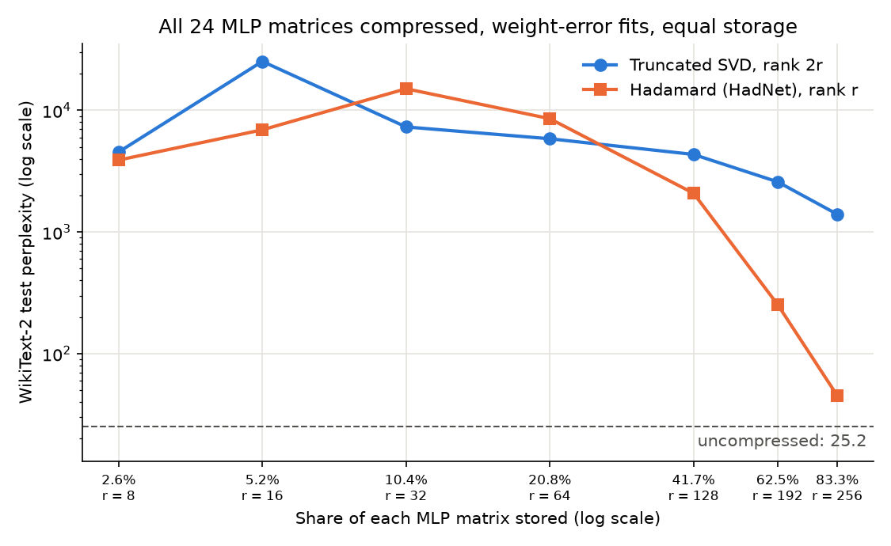

- **Weight error.** HadNet has the lower weight error on 85 of 96 matrix fits. That is expected: GPT-2's MLP spectra are flat, and the top 128 singular values hold only 40.5–48.1% of each matrix's energy (`results/stage1/spectra.npz`). Prop 3.5 allows a large gain only for flat spectra.
- **Perplexity.** Every model is broken, and the curves are not monotone in r. HadNet loses at r = 32 and 64 despite its lower weight error on most matrices.

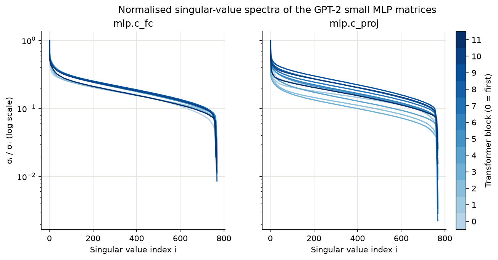

**Question for stage 2:** why doesn't the better weight approximation give a better model?

## Stage 2: diagnostics

**Finding: there is no bug. At larger budgets HadNet gives far better models than SVD. The six worst single-matrix runs all lie in blocks 0 and 1, and neither weight error nor output error predicts the damage one matrix does on its own.**

**Why it follows.** Stage 1's mismatch could be a bug, or the wrong error being measured, or a few matrices doing most of the damage.

**What was run** (`experiments/stage2_diagnostics.py`, `results/stage2/diagnostics.csv`):
- the bug check of the Verification table;
- all 24 matrices at the larger budgets r = 64, 128, 192, 256;
- each matrix compressed alone at r = 64 and 128 (96 runs);
- for every fit, the output error on calibration inputs and entrywise error statistics.

| r | share stored | SVD perplexity | HadNet perplexity | SVD weight / output error | HadNet weight / output error |
|---|---|---|---|---|---|
| 64 | 20.8% | 5,843 | 8,547 | 0.748 / 0.489 | 0.691 / 0.529 |
| 128 | 41.7% | 4,343 | 2,083 | 0.589 / 0.390 | 0.477 / 0.403 |
| 192 | 62.5% | 2,586 | 253.4 | 0.449 / 0.305 | 0.291 / 0.269 |
| 256 | 83.3% | 1,399 | 45.2 | 0.318 / 0.225 | 0.185 / 0.186 |

The r = 64 run is the same as stage 1's (identical perplexities in both files).

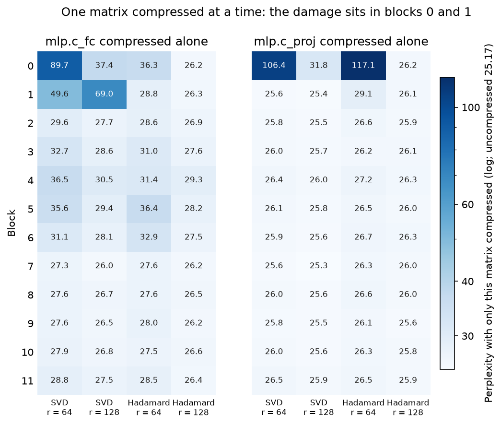

- **Larger budgets.** From r = 128 up, HadNet's models are far better: 45.2 against 1,399 at r = 256. HadNet has the lower weight error on 71 of 72 matrix fits at r > 64.
- **No outlier entries.** At r = 64, HadNet's largest entrywise error is smaller than SVD's on all 24 matrices (mean 0.75 against 2.20).
- **Single matrices.** Compressed one at a time, the median perplexity is 26.5. The six worst runs (37.4–117.1) all compress block 0's `c_fc` or `c_proj`, or block 1's `c_fc`.
- **What predicts single-matrix damage.** Neither error measure does. The Spearman correlations with single-matrix perplexity are +0.08 (weight error) and −0.38 (output error) for SVD, and +0.56 and −0.12 for HadNet (48 runs each). Which matrix is compressed matters more than how large its error is.
- **What predicts damage when all matrices are compressed.** Across the 8 runs that compress all 24 matrices, both measures track perplexity: Spearman +0.95 for mean weight error and +0.90 for mean output error. *(The project's summary table originally credited output error alone here. These 8 runs do not separate the two measures; stage 3's runs do.)*

**Question for stage 3:** if blocks 0–1 are protected and the fit targets the error on real inputs, how much better do the models get?

## Stage 3: activation-aware fits

**Finding: fitting the output error is the largest improvement in the project. Weighted HadNet wins at r = 64; whitened SVD wins at r = 128 and 256, where weighted HadNet's `c_proj` fits barely move.**

**Why it follows.** Stage 2 pointed at blocks 0–1, and at the error the network actually feels.

**What was run** (`experiments/stage3_activation_aware.py`, `results/stage3/activation_aware.csv`). Blocks 0 and 1 stay whole, and the 20 MLP matrices of blocks 2–11 are compressed together. Four methods at equal storage, each run measured once:
- SVD at rank 2r and HadNet at rank r (weight error);
- whitened SVD at rank 2r and weighted HadNet at rank r (output error, G_fit).

All HadNet fits use the paper's settings, including learning rate 0.1.

| r | share of all MLP weights stored | SVD | HadNet | whitened SVD | weighted HadNet |
|---|---|---|---|---|---|
| 64 | 34.0% | 1,042 | 1,122 | 252.2 | **90.0** |
| 128 | 51.4% | 376.7 | 398.0 | **59.1** | 76.5 |
| 256 | 86.1% | 62.9 | 38.5 | **29.3** | 41.9 |

WikiText-2 test perplexity. Mean output error of the same runs:

| r | SVD | HadNet | whitened SVD | weighted HadNet |
|---|---|---|---|---|
| 64 | 0.498 | 0.543 | 0.409 | 0.375 |
| 128 | 0.397 | 0.419 | 0.307 | 0.353 |
| 256 | 0.228 | 0.183 | 0.157 | 0.263 |

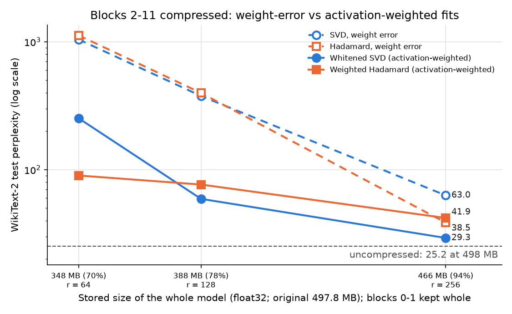

- **Size of the effect.** At equal storage, fitting output error improves perplexity 2–6× for SVD, and 5–12× for HadNet at r ≤ 128.
- **Output error now predicts perplexity.** Across these 12 runs, mean output error has Spearman +0.97 with perplexity; mean weight error only +0.63, because the weighted fits trade weight error for output error.
- **Where weighted HadNet wins and loses.** It has a lower output error than whitened SVD on all 10 `c_fc` matrices at every r. On `c_proj` it wins on 10, 4 and 2 of 10 at r = 64, 128, 256.
- **The `c_proj` failure.** On `c_proj` in blocks 3–8 at r ≥ 128, weighted HadNet's output error stays within 0.05 of its weight error (0.565–0.770). At r = 256 its mean `c_proj` output error (0.471) is worse than plain HadNet's (0.247), which never saw that loss. The optimiser did not get far on these matrices.

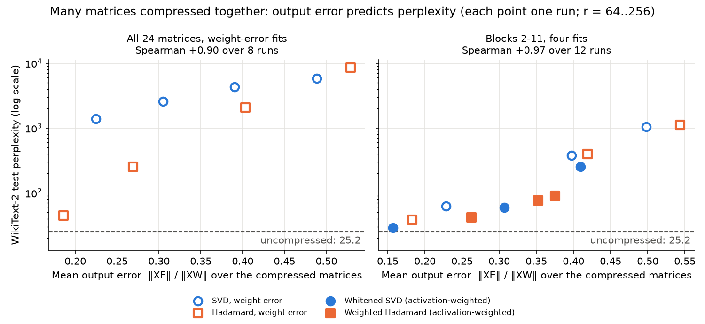
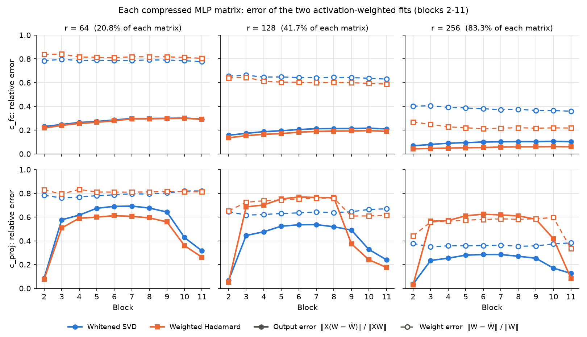

**Question for stage 4:** where does the damage come from, block by block?

## Stage 4: cumulative damage

**Finding: each block multiplies perplexity, and the damage concentrates in blocks 3–8, following the output error of their `c_proj`.**

**Why it follows.** Stage 3 measured whole runs; this stage splits them by block.

**What was run** (`experiments/stage4_cumulative.py`, `results/stage4/cumulative.csv`). With whitened SVD and weighted HadNet, blocks 2, 3, …, 11 are compressed one after another, and perplexity is measured after each block. Each sequence ends on exactly the matching stage 3 run.

| Blocks compressed | whitened SVD, r = 64 | weighted HadNet, r = 64 | whitened SVD, r = 128 | weighted HadNet, r = 128 | whitened SVD, r = 256 | weighted HadNet, r = 256 |
|---|---|---|---|---|---|---|
| 2 | 26.22 | 26.47 | 25.78 | 25.93 | 25.40 | 25.44 |
| 2–3 | 29.33 | 28.77 | 26.89 | 27.75 | 25.63 | 26.15 |
| 2–4 | 42.47 | 33.40 | 28.95 | 32.32 | 26.15 | 27.75 |
| 2–5 | 71.27 | 40.92 | 32.55 | 38.21 | 26.49 | 29.83 |
| 2–6 | 129.60 | 51.96 | 38.25 | 46.25 | 27.03 | 32.37 |
| 2–7 | 137.26 | 57.80 | 41.75 | 55.36 | 27.40 | 34.08 |
| 2–8 | 185.50 | 68.38 | 46.70 | 66.77 | 27.90 | 37.17 |
| 2–9 | 216.81 | 77.87 | 51.24 | 70.25 | 28.32 | 38.63 |
| 2–10 | 236.48 | 87.53 | 55.49 | 74.95 | 28.79 | 41.25 |
| 2–11 | 252.21 | 90.04 | 59.14 | 76.51 | 29.27 | 41.93 |

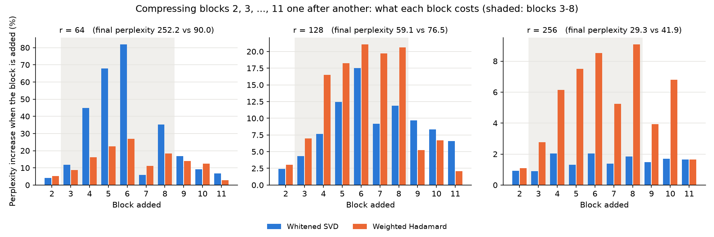

- **Multiplication.** Each added block multiplies perplexity by between 1.009 and 1.818.
- **Concentration.** Blocks 3–8 cause 70–85% of the total increase in log perplexity at r ≤ 128, and 62–74% at r = 256.
- **What a block's cost follows.** It follows the output error of its `c_proj`: Spearman +0.78 over all 60 steps, against +0.60 for `c_fc`.
- **Smooth at r = 256.** With whitened SVD at r = 256, every block costs at most 2.1% perplexity. *(Earlier write-ups said "under 2%"; blocks 4 and 6 each cost 2.03%.)*

**Question for stage 5:** is stage 3's `c_proj` failure a property of the Hadamard form or of the optimiser? Answering that needs single matrices, where every quantity can be inspected.

## Stage 5: single matrices

**Finding: the spectrum decides plain SVD against HadNet, as Prop 3.5 predicts. Under a weighted error on an image, whitened SVD wins every case. On GPT-2's block 5 `c_proj`, stage 3's failure was the learning rate.**

**Why it follows.** Stages 3–4 cannot separate the method from its optimiser. A single matrix can.

**What was run.**
- **Image** (`experiments/stage5_single_image.py`). `skimage.data.astronaut()` in grayscale, values in [0, 1], resized with anti-aliasing to n = 64, 128, 256, 512, at storage shares 4r/n of 6.25, 12.5, 25 and 50% (r = n/64 … n/8).
- **Control.** A 256 × 256 standard Gaussian matrix (seed 42).
- **Weightings** (`src/weights.py`, normalised to mean(diag G) = 1, G on the row index):
  - identity (κ = 1);
  - *region*: G = D², with d = 10 on the middle third of the rows and 1 elsewhere (κ = 100);
  - *frequency*: G = Cᵀ diag(w) C, where C is the orthonormal DCT-II and w_k = κ^(−k/(n−1)), for κ = 10, 100, 1000. Errors in smooth vertical content cost up to κ times more.
- **Precision.** All image fits run in float64 on the CPU.
- **Metrics.** PSNR = 10·log₁₀(1/MSE) in dB, with no clipping.

### 5.1 Spectrum and Prop 3.5

**Finding: SVD(2r) beats HadNet(r) on the image at every n and share; the flat-spectrum control reverses this at every share.**

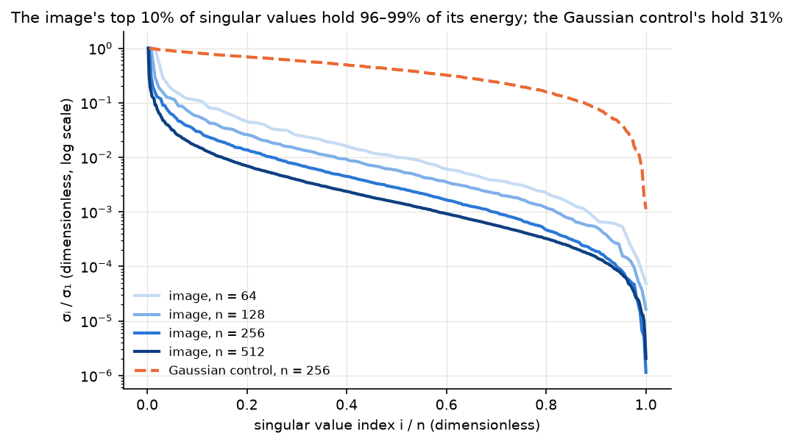

| matrix | n | share | r | SVD(2r) | HadNet(r) | SVD(r) | PSNR dB, SVD(2r) / HadNet | Prop 3.5 bound / ‖A‖² | gain / ‖A‖² |
|---|---|---|---|---|---|---|---|---|---|
| image | 64 | 6.25% | 1 | 0.3281 | 0.4203 | 0.4203 | 15.4 / 13.2 | 0 | −6.90e−02 |
| image | 64 | 12.5% | 2 | 0.2482 | 0.3292 | 0.3281 | 17.8 / 15.4 | 0 | −4.68e−02 |
| image | 64 | 25% | 4 | 0.1565 | 0.2502 | 0.2482 | 21.8 / 17.7 | 1.88e−02 | −3.81e−02 |
| image | 64 | 50% | 8 | 0.0757 | 0.1413 | 0.1565 | 28.1 / 22.7 | 5.72e−03 | −1.42e−02 |
| image | 128 | 6.25% | 2 | 0.2837 | 0.3589 | 0.3582 | 16.5 / 14.5 | 0 | −4.83e−02 |
| image | 128 | 12.5% | 4 | 0.1982 | 0.2845 | 0.2837 | 19.6 / 16.5 | 2.48e−02 | −4.17e−02 |
| image | 128 | 25% | 8 | 0.1202 | 0.1807 | 0.1982 | 24.0 / 20.4 | 1.41e−02 | −1.82e−02 |
| image | 128 | 50% | 16 | 0.0593 | 0.1036 | 0.1202 | 30.1 / 25.3 | 3.52e−03 | −7.21e−03 |
| image | 256 | 6.25% | 4 | 0.2215 | 0.3026 | 0.3025 | 18.6 / 15.9 | 2.72e−02 | −4.25e−02 |
| image | 256 | 12.5% | 8 | 0.1480 | 0.2053 | 0.2215 | 22.1 / 19.3 | 2.01e−02 | −2.02e−02 |
| image | 256 | 25% | 16 | 0.0890 | 0.1321 | 0.1480 | 26.5 / 23.1 | 7.92e−03 | −9.52e−03 |
| image | 256 | 50% | 32 | 0.0425 | 0.0752 | 0.0890 | 33.0 / 28.0 | 1.80e−03 | −3.85e−03 |
| image | 512 | 6.25% | 8 | 0.1660 | 0.2198 | 0.2356 | 21.1 / 18.6 | 2.32e−02 | −2.08e−02 |
| image | 512 | 12.5% | 16 | 0.1106 | 0.1512 | 0.1660 | 24.6 / 21.9 | 1.21e−02 | −1.06e−02 |
| image | 512 | 25% | 32 | 0.0657 | 0.0969 | 0.1106 | 29.1 / 25.8 | 4.31e−03 | −5.07e−03 |
| image | 512 | 50% | 64 | 0.0319 | 0.0544 | 0.0657 | 35.4 / 30.8 | 1.02e−03 | −1.95e−03 |
| control | 256 | 6.25% | 4 | 0.9411 | 0.9300 | 0.9696 | – | 9.91e−02 | +2.09e−02 |
| control | 256 | 12.5% | 8 | 0.8869 | 0.8429 | 0.9411 | – | 4.13e−01 | +7.61e−02 |
| control | 256 | 25% | 16 | 0.7873 | 0.6823 | 0.8869 | – | 6.20e−01 | +1.54e−01 |
| control | 256 | 50% | 32 | 0.6110 | 0.4170 | 0.7873 | – | 3.73e−01 | +1.99e−01 |

Relative plain error (`results/stage5/s51_spectrum.csv`). The gain is ‖A − A₂ᵣ‖² − ‖A − Â‖² for HadNet.

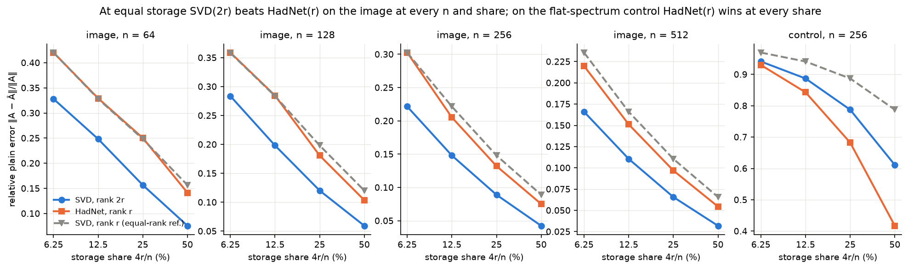

- **Energy.** The image's top 10% of singular values hold 96.1–99.4% of its energy; the control's hold 31.2%.
- **Image.** The bound allows a gain of up to 2.7% of ‖A‖², but the actual gain is negative everywhere.
- **Control.** The gain is positive, reaching 20% of ‖A‖² at 50% share.
- **HadNet against SVD(r).** HadNet(r) beats SVD at equal *rank* r (the paper's comparison) from r = 8 up. In five small-r cases it ends slightly above SVD(r), by up to 0.34%. The Hadamard form contains every rank-r matrix (5.3), so these are optimiser shortfalls.

### 5.2 The four methods under each weighting

**Finding: whitened SVD has the lowest weighted error in all 80 image cases; weighted HadNet at the paper's settings trails it by 10–121%, mostly depending on the storage share.**

Gap of weighted HadNet to whitened SVD, (wHadNet − wSVD)/wSVD in weighted error (`results/stage5/s52_weightings.csv`):

| n | share | r | identity | region | κ = 10 | κ = 100 | κ = 1000 |
|---|---|---|---|---|---|---|---|
| 64 | 6.25% | 1 | +28.1% | +46.5% | +34.1% | +39.8% | +45.4% |
| 64 | 12.5% | 2 | +32.6% | +79.6% | +38.7% | +39.9% | +43.1% |
| 64 | 25% | 4 | +59.8% | +80.7% | +68.6% | +46.1% | +41.6% |
| 64 | 50% | 8 | +86.8% | +119.4% | +120.2% | +121.2% | +102.6% |
| 128 | 6.25% | 2 | +26.5% | +57.6% | +27.5% | +29.7% | +31.3% |
| 128 | 12.5% | 4 | +43.6% | +50.6% | +51.2% | +27.4% | +24.2% |
| 128 | 25% | 8 | +50.4% | +62.2% | +68.8% | +53.1% | +35.7% |
| 128 | 50% | 16 | +74.6% | +106.7% | +96.7% | +111.9% | +103.2% |
| 256 | 6.25% | 4 | +36.6% | +38.7% | +40.4% | +17.6% | +13.3% |
| 256 | 12.5% | 8 | +38.7% | +45.5% | +47.8% | +28.3% | +16.7% |
| 256 | 25% | 16 | +48.4% | +67.8% | +59.6% | +49.4% | +31.5% |
| 256 | 50% | 32 | +77.1% | +115.8% | +103.0% | +116.5% | +100.9% |
| 512 | 6.25% | 8 | +32.4% | +35.4% | +36.6% | +20.1% | +9.8% |
| 512 | 12.5% | 16 | +36.7% | +47.0% | +43.2% | +27.9% | +14.1% |
| 512 | 25% | 32 | +47.5% | +64.1% | +61.5% | +54.8% | +32.5% |
| 512 | 50% | 64 | +70.8% | +99.3% | +96.7% | +114.0% | +103.9% |

Relative weighted error of the four methods at n = 256:

| weighting | share | SVD(2r) | HadNet(r) | whitened SVD(2r) | weighted HadNet(r) |
|---|---|---|---|---|---|
| region | 6.25% | 0.2197 | 0.3288 | 0.1535 | 0.2130 |
| region | 12.5% | 0.1539 | 0.2155 | 0.0994 | 0.1446 |
| region | 25% | 0.0940 | 0.1369 | 0.0530 | 0.0889 |
| region | 50% | 0.0451 | 0.0803 | 0.0204 | 0.0441 |
| κ = 1000 | 6.25% | 0.1674 | 0.2493 | 0.1657 | 0.1878 |
| κ = 1000 | 12.5% | 0.0934 | 0.1519 | 0.0915 | 0.1067 |
| κ = 1000 | 25% | 0.0443 | 0.0801 | 0.0417 | 0.0548 |
| κ = 1000 | 50% | 0.0150 | 0.0369 | 0.0126 | 0.0253 |

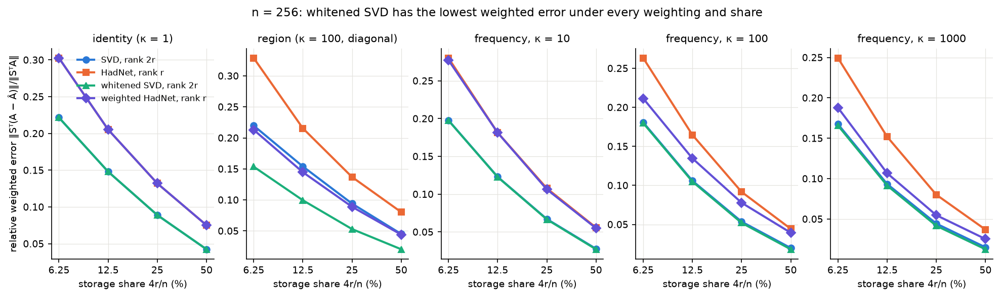


- **Dependence on κ.** The gap does not grow with conditioning. At shares ≤ 25% it shrinks as κ goes from 10 to 1000 (n = 512, 6.25%: 36.6% → 9.8%); at 50% share it stays near 100%.
- **Stage 3's failure signature is rare here.** Weighted HadNet ends worse on its own loss than plain HadNet in 1 of 64 non-identity cases: n = 128, 25% share, κ = 10, at 0.1528 against 0.1512.

### 5.3 Starts and learning rates on the image

**Finding: on the image, neither the start nor the learning rate closes the gap; the six paper and warm-start configurations end at 1.55–1.56× whitened SVD's error on average.**

At n = 256 (region and κ = 10, 100, 1000; 4 shares), weighted HadNet ran from three starts:
- the paper's;
- a warm start from plain HadNet;
- the rank-r whitened SVD embedded as W₁H₁ = Â_r with W₂H₂ = all-ones.

Each start ran at learning rates 0.1, 0.03 and 0.01 (`results/stage5/s53_fix.csv`).

| start | lr | mean ratio to whitened SVD | min | max | runs worse than plain HadNet | median best step |
|---|---|---|---|---|---|---|
| paper | 0.1 | 1.558 | 1.133 | 2.165 | 0/16 | 1999 |
| paper | 0.03 | 1.563 | 1.138 | 2.168 | 0/16 | 1999 |
| paper | 0.01 | 1.560 | 1.159 | 2.174 | 0/16 | 1999 |
| warm | 0.1 | 1.552 | 1.161 | 2.165 | 0/16 | 1999 |
| warm | 0.03 | 1.556 | 1.160 | 2.173 | 0/16 | 1999 |
| warm | 0.01 | 1.558 | 1.163 | 2.180 | 0/16 | 1999 |
| embedding | any | 1.978 | 1.418 | 3.311 | 9/16 | 0 |

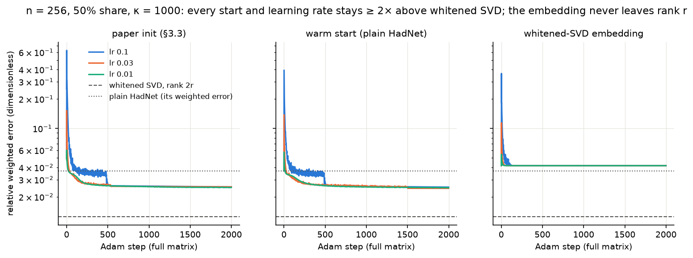

- **Warm start.** It is never worse than plain HadNet: 0 of 48 runs at n = 256, and 0 of 32 in the repeat of the two best configurations at n = 512, where the mean ratios are 1.541 and 1.535.
- **Hardest case** (n = 256, 50% share, κ = 1000). Every paper and warm-start run ends at 0.024–0.025, against whitened SVD's 0.0126.
- **The embedding is stuck.** Its unused W₂/H₂ slots get exactly zero gradient (check 13), so Adam never moves them. The fit stays at rank r and returns its start (best step 0).
- **Why rank r but not rank 2r.**
  - *Every rank-r matrix fits:* X = X ∘ 𝟙, with 𝟙 the rank-1 all-ones matrix.
  - *Generic rank-2r matrices do not, once m + n > 4r².* Each row of E (M1) is a rank-one r × r matrix, so the Hadamard set has dimension at most (2r − 1)(m + n), less than the 2r(m + n) − 4r² of the rank-2r matrices. For r = 1 this is immediate.

### 5.4 The diagonal case

**Finding: a diagonal weighting folds into the factors exactly; the two routes reach the same weighted error to within ±5%, the difference coming from the optimiser's path.**

For G = D², D(X ∘ Y) = (DX) ∘ Y. So weighted HadNet on (A, D²) is plain HadNet on DA with W₁ ← D⁻¹W₁, and whitened SVD is D⁻¹[DA]₂ᵣ. Both identities hold to ≤ 5.1·10⁻¹⁴ at every n (`results/stage5/s54_diagonal.csv`). Under the region weighting, the two runs' final weighted errors agree exactly at r ≤ 2 and differ by up to 4.9% at larger r: 0.0321 against 0.0337 at n = 512, 50% share. The folded run is better in 6 of 16 cases.

### 5.5 GPT-2 block 5 `c_proj`, r = 128

**Finding: at learning rate 0.1, weighted HadNet never improves on any start; at 0.03 or 0.01 it beats whitened SVD's weighted error by 24–26%.**

This is stage 3's matrix and calibration, in float32 on the GPU (`experiments/stage5_gpt2_single_matrix.py`, `results/stage5/s55_gpt2.csv`). cond(G) = 4.04·10⁴ and cond(G_fit) = 2.44·10⁴ (`results/stage5/s55_conditions.csv`).

| method | start | lr | plain error | output error (G) | weighted error (G_fit) | best step |
|---|---|---|---|---|---|---|
| SVD(2r) | – | – | 0.5832 | 0.5994 | 0.5991 | – |
| HadNet | paper | 0.1 | 0.4750 | 0.6388 | 0.6357 | 1991 |
| whitened SVD(2r) | – | – | 0.6302 | 0.5232 | 0.5257 | – |
| weighted HadNet | paper | 0.1 | 0.7445 | 0.7524 | 0.7522 | 0 |
| weighted HadNet | paper | 0.03 | 0.5840 | 0.3896 | 0.3948 | 1999 |
| weighted HadNet | paper | 0.01 | 0.5772 | **0.3877** | 0.3928 | 1999 |
| weighted HadNet | warm | 0.1 | 0.4750 | 0.6388 | 0.6357 | 0 |
| weighted HadNet | warm | 0.03 | 0.5744 | 0.4000 | 0.4045 | 1999 |
| weighted HadNet | warm | 0.01 | 0.5488 | 0.3987 | 0.4025 | 1999 |
| weighted HadNet | embedding | any | 0.7801 | 0.6745 | 0.6770 | 0 |


- **Stage 3 reproduced.** The first four rows reproduce stage 3's values for this matrix.
- **Learning rate 0.1.** Stage 3's weighted HadNet result for this matrix is simply its starting point: the best loss is at step 0. The first Adam steps raise the loss by two orders of magnitude (figure), and it never comes back below the start.
- **Learning rate 0.03 or 0.01.** The loss is still falling at step 2000.

**Open question:** does this hold for the other 19 matrices, and for perplexity?

## Model size

Only the 24 MLP matrices are compressed, so the saving on the whole model is modest. Sizes are computed with `src/methods.py` (`model_megabytes`), at float32. Uncompressed, the model is 497.8 MB.

| Setting | r | Stored size | Of original | Best perplexity |
|---|---|---|---|---|
| All 24 matrices, weight-error fit | 8 | 277.2 MB | 55.7% | 3,904 (HadNet) |
| All 24 matrices, weight-error fit | 256 | 460.0 MB | 92.4% | 45.2 (HadNet) |
| Blocks 2–11, activation-aware | 64 | 348.3 MB | 70.0% | 90.0 (weighted HadNet) |
| Blocks 2–11, activation-aware | 128 | 387.7 MB | 77.9% | 59.1 (whitened SVD) |
| Blocks 2–11, activation-aware | 256 | 466.3 MB | 93.7% | 29.3 (whitened SVD) |

These are stored sizes. The experiments rebuild each dense matrix, so speed and memory while running are unchanged. The best usable model saves 6.3% (29.3 at 466 MB).

## Conclusions

**Established**
- **Spectrum shape decides plain SVD against HadNet at equal storage.** SVD(2r) wins on a natural image at every size and share, and HadNet(r) wins on a flat Gaussian control at every share. Prop 3.5's bound holds in all 20 cases. On GPT-2's flat MLP spectra, HadNet has the lower weight error (156 of 168 fits).
- **Activation-aware fitting is the largest effect.** At equal storage it improves perplexity 2–12× (stage 3). Across many-matrix runs mean output error predicts perplexity (Spearman +0.97), and weight error does not once fits differ in what they optimise (+0.63).
- **Damage is concentrated.** It is concentrated by matrix: the six worst single-matrix runs are in blocks 0–1. And by block: blocks 3–8 cause 62–85% of the log-perplexity increase, following `c_proj` output error.
- **Image, weighted error.** Whitened SVD beats weighted HadNet in every image case (80 of 80), whatever the start or learning rate among those tried.
- **The rank-r embedding cannot move under gradient descent** (exact zero gradient). A diagonal weighting folds exactly into the factors.

**Suggested**
- **Stage 3's `c_proj` failure was an optimisation issue, not a limit of the Hadamard form.** On block 5's `c_proj` the paper's learning rate makes no progress, and a lower one beats whitened SVD by 24–26%. This was shown on **one matrix**.
- **Whether weighted HadNet helps depends on the spectrum of SᵀA, not of A.** The image's weighted spectra are steep; GPT-2's are flat.

**Speculative**
- That weighted HadNet at a lower learning rate would also win on perplexity at r = 128 and 256.
- That 0.388 is near the best the Hadamard form can do on that matrix: the loss was still falling.

## Limitations

- **One-shot calibration.** The Gram matrices come from the uncompressed model; later blocks never see the errors of earlier ones.
- **No retraining** after compression.
- **Stage 3's storage differs from stage 1's,** because blocks 0–1 are left whole (34.0–86.1% of the MLP weights stored, against 2.6–83.3% of each matrix in stages 1–2).
- **The learning-rate result is on a single matrix** (stage 5.5), at one rank.
- **The rank-r whitened-SVD start of stage 5.3 sits at a saddle point.** Its all-ones factor leaves r − 1 slots with exactly zero gradient, a design flaw of that variant.
- **Small samples.** One model, one dataset, one image, one random control. All fits are deterministic, so there are no error bars.
- **Fixed step budget.** HadNet runs exactly 2000 steps; several fits were still improving.
- **Bug check numbers.** Its perplexities were printed, not saved, so they are not quoted.

## Open questions and next steps (ranked)

1. **Does the learning-rate fix hold across all 20 matrices of blocks 2–11, and does it change perplexity at r = 128 and 256?** Not run. Choose the learning rate from the calibration loss only, never from test perplexity.
2. **A principled fit under a full weighting.** Is there an exact way to fit the Hadamard form under a non-diagonal weighting, the way whitening solves it for SVD? A diagonal weighting folds into the factors exactly (5.4). For a full G, Sᵀ(X ∘ Y) ≠ (SᵀX) ∘ Y, so the problem does not reduce to a plain fit of SᵀA. Alternating weighted least squares on one factor pair at a time is a candidate: each subproblem is linear.
3. **A scale-aware step size.** Replace the fixed lr 0.1 with a step size scaled to the factor magnitudes.
4. **Spectrum of SᵀA.** Measure it and test whether Prop 3.5 computed on SᵀA predicts when weighted HadNet beats whitened SVD.
5. **Blocks 3–8.** Give them more storage than blocks 2 and 9–11.
6. **Calibration and retraining.** Recompute the Gram matrices from the partly compressed model, and add a short fine-tune.

## Reproduction

Python 3.12 (versions in `requirements.txt`). Stages 1–4 and 5.5 need a CUDA GPU with about 6 GB, and download GPT-2 small and WikiText-2 from the Hugging Face Hub on first use. Times are for an RTX 4050 laptop GPU and 8 CPU threads.

```
python -m venv .venv && source .venv/bin/activate
pip install -r requirements.txt
python tests/checks.py                          # 16 checks, ~6 s
python experiments/stage1_plain_fits.py         # ~11 min
python experiments/stage2_diagnostics.py        # ~75 min
python experiments/stage3_activation_aware.py   # ~35 min
python experiments/stage4_cumulative.py         # ~50 min
python experiments/stage5_single_image.py       # ~27 min (CPU, float64)
python experiments/stage5_gpt2_single_matrix.py # ~3.5 min
python experiments/plot.py                      # every figure, ~20 s
```

**Provenance.**
- **When each stage ran.** Stages 1–4 were run first, as one version of this project (16 November 2026). Stage 5 was run as a second version (18 November 2026). This layout merges the two without re-running anything: every result file and figure is byte-identical to the one the runs produced.
- **Tags.**
  - `v1-weight-error` (commit 3cf6c77): stages 1–2 in their original flat layout.
  - `pre-restructure-main` (commit 9203280): stages 1–4 exactly as run.
  - `pre-restructure-v2`: stage 5 as run, before this restructuring.
  - `v2-final`: this layout.
- **Stages 3–4 and today's code.** They were run with the weighted loss written in the transposed form, G on the column index of an (out, in) matrix. `src/methods.py` now fits the transpose under the row form: the same loss, but a different float32 operation order. Weighted HadNet at learning rate 0.1 follows a path that depends on rounding, so a re-run need not reproduce stage 3's per-matrix numbers digit for digit. For the exact code, check out `pre-restructure-main`.
- **The paper's PDF** is not in the repository (copyrighted; `.gitignore` excludes PDFs), so there is no `papers/` folder. It is available at <https://doi.org/10.1016/j.neucom.2026.134372>.

**Sources.**
- Paper: Panchal, Sahoo, Behera, Neurocomputing 699 (2026) 134372; code <https://github.com/PanchalAneesh/HadNet-HadDNN>.
- SVD-LLM: <https://arxiv.org/abs/2403.07378>; code <https://github.com/AIoT-MLSys-Lab/SVD-LLM>.
- ASVD: <https://arxiv.org/abs/2312.05821>.
- Perplexity guide: <https://huggingface.co/docs/transformers/perplexity>.
- Model and data: `gpt2` and `Salesforce/wikitext` (`wikitext-2-raw-v1`) on the Hugging Face Hub.
- Image: `skimage.data.astronaut()`, a public-domain NASA photograph.

## Appendix: number spot-checks

Check 16 of `tests/checks.py` re-reads every row from its file: the value printed here must equal the file's value formatted to the digits shown.

| # | Value | File | Row | Column |
|---|---|---|---|---|
| 1 | 25.17 | results/stage1/results.csv | method=baseline | perplexity |
| 2 | 3904 | results/stage1/results.csv | method=hadamard; r=8; layer=0; matrix=c_fc | perplexity |
| 3 | 25286 | results/stage1/results.csv | method=svd; r=16; layer=0; matrix=c_fc | perplexity |
| 4 | 15063 | results/stage1/results.csv | method=hadamard; r=32; layer=0; matrix=c_fc | perplexity |
| 5 | 1399 | results/stage2/diagnostics.csv | method=svd; r=256; layer=0; matrix=c_fc | perplexity_all |
| 6 | 45.2 | results/stage2/diagnostics.csv | method=hadamard; r=256; layer=0; matrix=c_fc | perplexity_all |
| 7 | 253.4 | results/stage2/diagnostics.csv | method=hadamard; r=192; layer=0; matrix=c_fc | perplexity_all |
| 8 | 117.1 | results/stage2/diagnostics.csv | method=hadamard; r=64; layer=0; matrix=c_proj | perplexity_single |
| 9 | 90.04 | results/stage3/activation_aware.csv | method=hadamard_w; r=64; layer=2; matrix=c_fc | perplexity |
| 10 | 252.21 | results/stage3/activation_aware.csv | method=svd_w; r=64; layer=2; matrix=c_fc | perplexity |
| 11 | 59.14 | results/stage3/activation_aware.csv | method=svd_w; r=128; layer=2; matrix=c_fc | perplexity |
| 12 | 29.27 | results/stage3/activation_aware.csv | method=svd_w; r=256; layer=2; matrix=c_fc | perplexity |
| 13 | 34.0 | results/stage3/activation_aware.csv | method=svd; r=64; layer=2; matrix=c_fc | mlp_budget_percent |
| 14 | 71.27 | results/stage4/cumulative.csv | method=svd_w; r=64; last_block=5 | perplexity |
| 15 | 38.21 | results/stage4/cumulative.csv | method=hadamard_w; r=128; last_block=5 | perplexity |
| 16 | 0.1480 | results/stage5/s51_spectrum.csv | matrix=image; n=256; share=12.5; method=svd_2r | rel_err |
| 17 | 0.4170 | results/stage5/s51_spectrum.csv | matrix=control; n=256; share=50.0; method=hadnet | rel_err |
| 18 | 35.4 | results/stage5/s51_spectrum.csv | matrix=image; n=512; share=50.0; method=svd_2r | psnr |
| 19 | 0.1528 | results/stage5/s52_weightings.csv | n=128; share=25.0; weighting=freq10; method=whadnet | rel_werr |
| 20 | 0.0126 | results/stage5/s52_weightings.csv | n=256; share=50.0; weighting=freq1000; method=wsvd_2r | rel_werr |
| 21 | 0.0244 | results/stage5/s53_fix.csv | n=256; share=50.0; weighting=freq1000; init=warm; lr=0.03 | rel_werr |
| 22 | 0.0337 | results/stage5/s54_diagonal.csv | n=512; share=50.0 | rel_werr_fold |
| 23 | 0.3877 | results/stage5/s55_gpt2.csv | method=whadnet; init=paper; lr=0.01 | rel_werr_G |
| 24 | 0.5232 | results/stage5/s55_gpt2.csv | method=wsvd | rel_werr_G |
