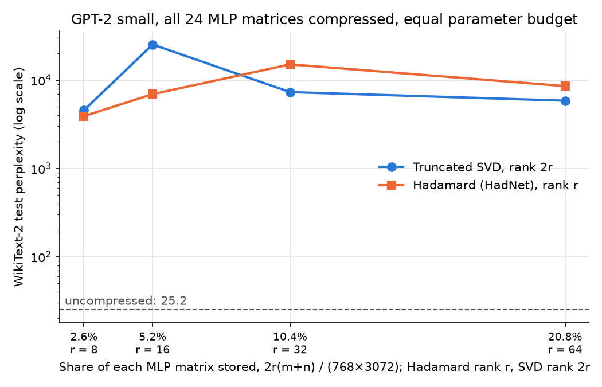
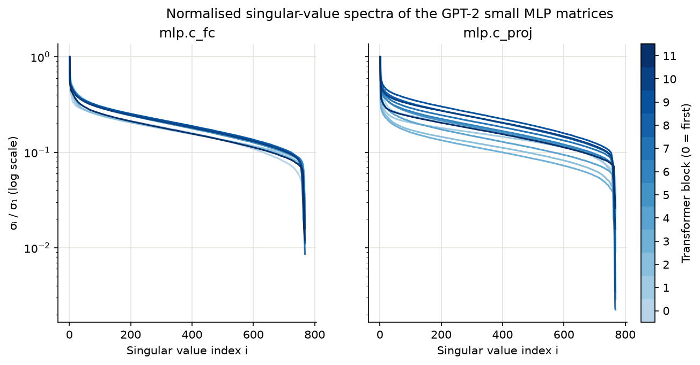
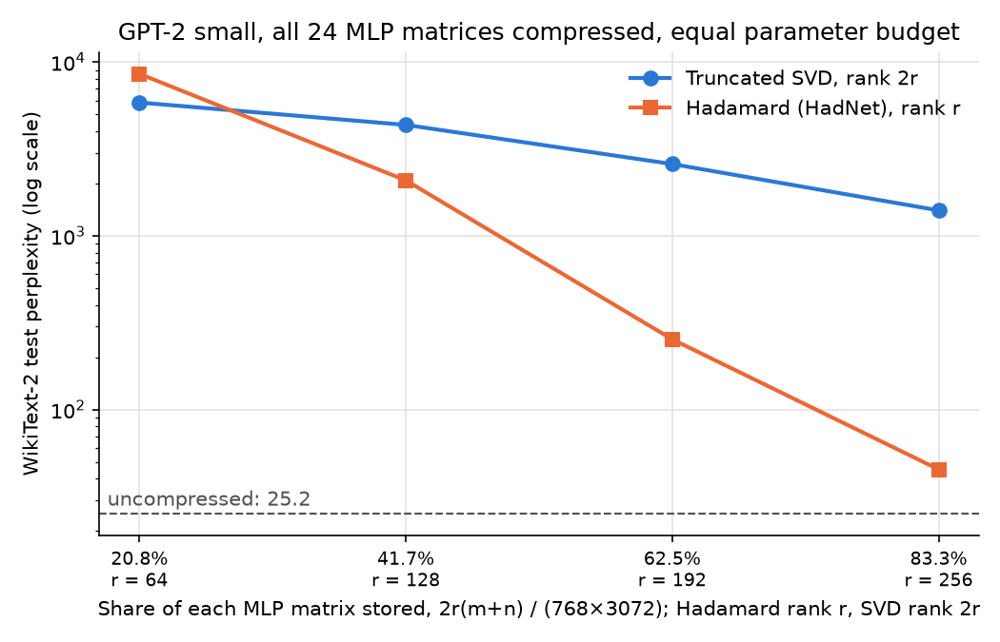
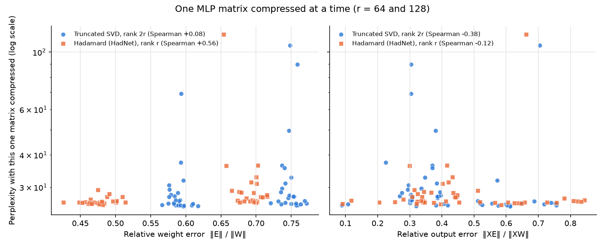
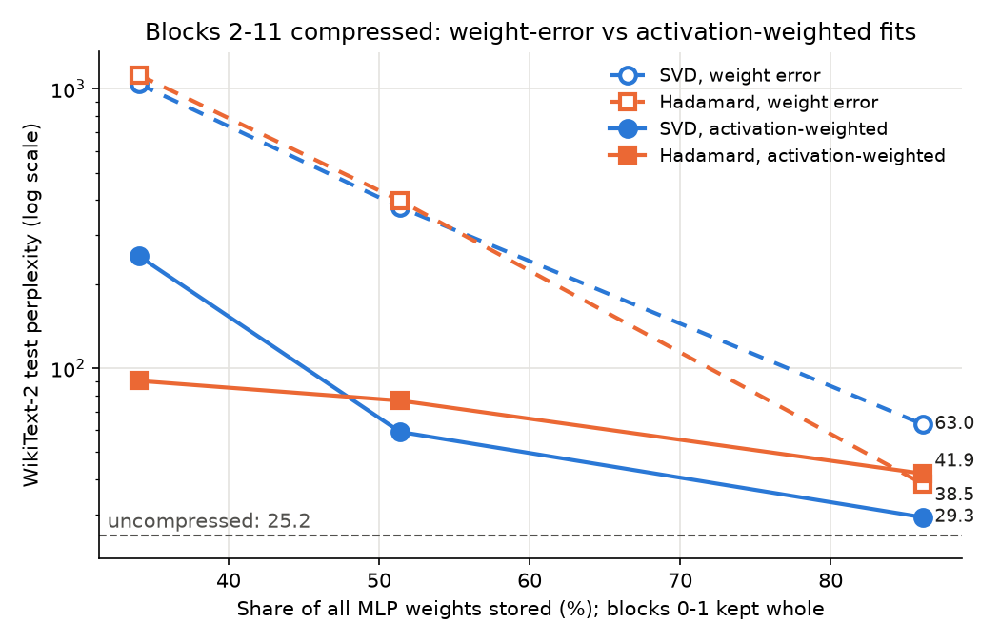
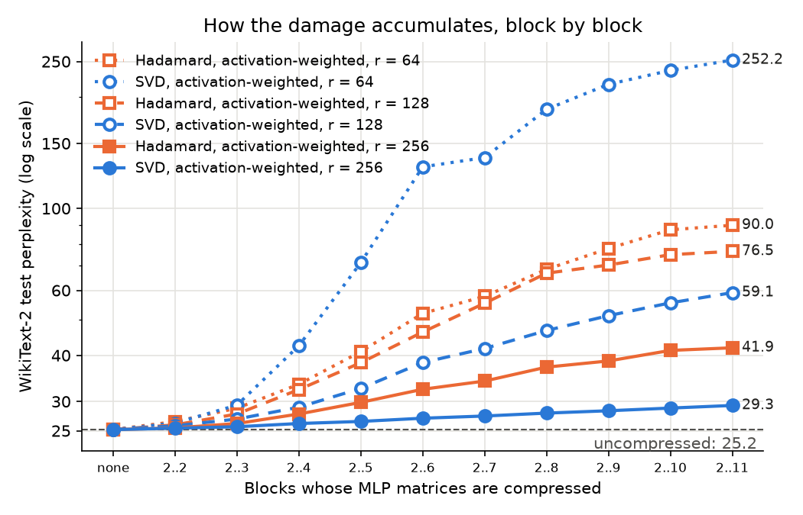
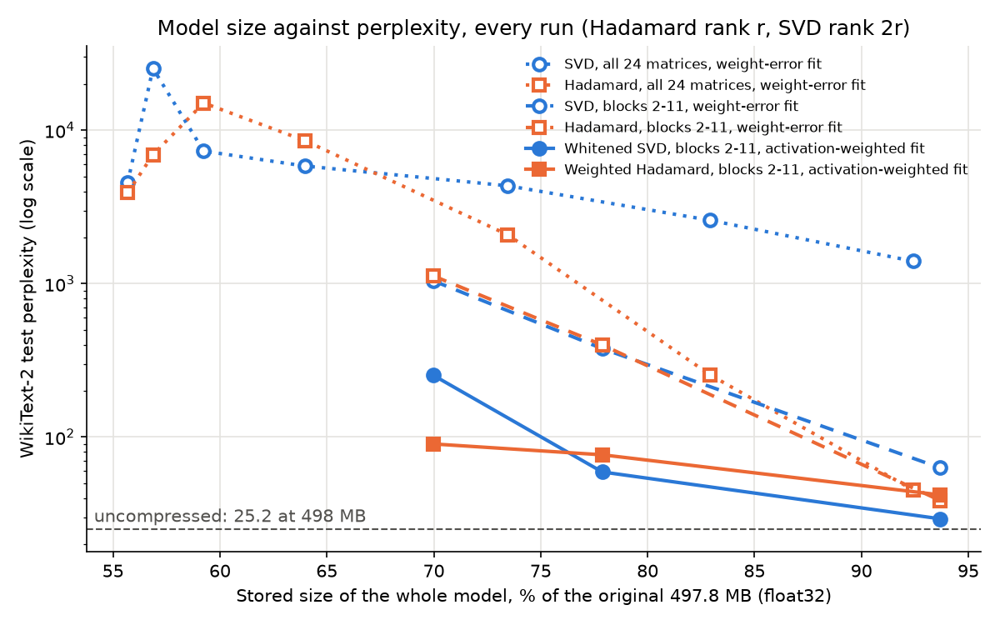

# Results and conclusions

Results of the experiments described in [`README.md`](../README.md): the Hadamard decomposition (HadNet) against truncated SVD at the same number of stored parameters, on the MLP matrices of GPT-2 small, measured by WikiText-2 test perplexity. The last section, "Activation-aware fitting, blocks 0 and 1 kept whole", covers the later runs. The method, the maths behind the checks and how to reproduce the numbers are in the README; the limits of the experiment are listed in its "Limits" section.

## Results: main experiment (r = 8 to 64)

One run, 15 November 2026, RTX 4050 laptop GPU, Python 3.12, torch 2.15.0, transformers 5.23.0, float32. Nothing in the pipeline is random, so there is no seed-to-seed spread to report. All numbers below are read from `results.csv`.

Uncompressed GPT-2 small: perplexity **25.17** (window 1024, stride 512).

| r | Stored share of each matrix | SVD rank 2r: perplexity | Hadamard rank r: perplexity | Lower perplexity | SVD: mean rel. error | Hadamard: mean rel. error |
|---|---|---|---|---|---|---|
| 8 | 2.6% | 4,546 | 3,904 | Hadamard | 0.9320 | 0.9275 |
| 16 | 5.2% | 25,286 | 6,922 | Hadamard | 0.8978 | 0.8870 |
| 32 | 10.4% | 7,310 | 15,063 | SVD | 0.8419 | 0.8157 |
| 64 | 20.8% | 5,843 | 8,547 | SVD | 0.7480 | 0.6906 |

"Mean rel. error" is ‖W − Ŵ‖_F / ‖W‖_F averaged over the 24 matrices.

### What the numbers say

1. **Both methods break the model at every budget tested.** The best compressed perplexity is 3,904 against 25.17 uncompressed. For scale, guessing uniformly over GPT-2's 50,257 tokens gives perplexity 50,257. Even at r = 64 the weight error is 69–75% of the matrix norm.
2. **On perplexity the two methods split 2–2, and neither curve is monotone.** Hadamard is lower at r = 8 and r = 16; SVD is lower at r = 32 and r = 64. SVD gets worse from r = 8 to r = 16 and Hadamard gets worse from r = 8 to r = 32, although their weight errors fall steadily. With models this damaged, the perplexity ordering should not be read as a ranking of the methods.
3. **On weight error Hadamard wins almost everywhere, and by more as r grows.** It has the lower Frobenius error on 85 of the 96 (matrix, r) pairs: 15/24 at r = 8, 22/24 at r = 16, 24/24 at r = 32 and at r = 64. The 11 losses are all `c_fc` matrices at r = 8 (9) and r = 16 (2). The mean gap grows from 0.005 at r = 8 to 0.057 at r = 64.
4. **A lower weight error did not give a lower perplexity.** At r = 32 and r = 64 Hadamard has the lower error on all 24 matrices and the worse perplexity. With only `h[0].mlp.c_fc` compressed at r = 16, Hadamard had relative error 0.884 against 0.907 for SVD, and perplexity 49,851 against 5,733.
5. **The spectra are flat, which is the regime where the Hadamard form is expected to win on weight error.** After a sharp drop over the first few singular values, σᵢ/σ₁ stays between about 0.07 and 0.4 across almost all of the 768 values. The top 128 singular values hold only 41–46% of the squared norm in the six matrices inspected (blocks 0, 5, 11). This matches item 3 and `checks.py` check 6.

## Diagnostics

The main experiment left a puzzle: Hadamard had the lower weight error but often the worse perplexity. `diagnostics.py` measures three possible explanations. It changes nothing about how either method is fitted.

| | Hypothesis | What is measured |
|---|---|---|
| H3 | **Bug.** The weight in the model is not the one that was fitted (transpose, copy, dtype, device). | Near the break-even rank (r = 300; SVD at rank 600) one matrix is written into the model, read back, and its error compared with the error before writing. Perplexity with only that matrix replaced should stay close to 25.17. |
| H1 | **Error direction.** The network feels the output error ‖X(W − Ŵ)‖ on real inputs X, not the weight error ‖W − Ŵ‖. | Relative output error ‖XE‖_F / ‖XW‖_F with E = W − Ŵ, computed from the Gram matrix G = XᵀX of each layer's inputs on 64 × 512 tokens of the WikiText-2 **train** split. Compared with weight error as a predictor of perplexity when one matrix is compressed at a time. |
| H2 | **Outlier entries.** The Hadamard reconstruction has heavier-tailed entrywise errors. | max \|E\|, the 99.9th percentile of \|E\|, and the largest column norm of E over the median column norm. |

It also repeats the comparison at gentler budgets: each of the 24 matrices compressed alone at r = 64 and 128, and all 24 together at r = 64, 128, 192 and 256 (21% to 83% of each matrix stored).

All numbers below are from one run of `diagnostics.py` (15 November 2026, same machine and versions as above) and are read from `diagnostics.csv`.

### Short answer

- **H3 (bug): refuted.** The model holds exactly the fitted weights.
- **H1 (error direction): not supported as stated.** Relative output error is a worse predictor of single-matrix perplexity than weight error, and its rank correlation with perplexity is negative.
- **H2 (outlier entries): refuted.** Hadamard's entrywise errors are smaller and more evenly spread than SVD's at every budget where it loses.
- **The puzzle is specific to small budgets.** From r = 128 upwards, with all 24 matrices compressed, Hadamard is clearly better, and the gap widens to 45 against 1,399 at r = 256.

### H3: bug check

Only the named matrix is replaced. Uncompressed perplexity is 25.17.

| Matrix | Method | Rank | Weight error before writing | Weight error read back | Perplexity |
|---|---|---|---|---|---|
| `h[0].mlp.c_fc` | SVD | 600 | 0.211221 | 0.211221 | 26.28 |
| `h[0].mlp.c_fc` | Hadamard | 300 | 0.079341 | 0.079341 | 25.08 |
| `h[5].mlp.c_fc` | SVD | 600 | 0.222180 | 0.222180 | 25.61 |
| `h[5].mlp.c_fc` | Hadamard | 300 | 0.050389 | 0.050389 | 25.34 |

The errors agree, the layer's output equals `x @ W_hat + bias` for the fitted matrix, and the original weight is restored exactly. No bug was found. Near break-even, Hadamard has both the lower weight error and the perplexity closer to the baseline.

### Gentler budgets, all 24 matrices compressed

| r | Stored share | SVD rank 2r: perplexity | Hadamard rank r: perplexity | SVD: mean weight error | Hadamard: mean weight error | SVD: mean output error | Hadamard: mean output error |
|---|---|---|---|---|---|---|---|
| 64 | 20.8% | 5,843 | 8,547 | 0.748 | 0.691 | 0.489 | 0.529 |
| 128 | 41.7% | 4,343 | 2,083 | 0.589 | 0.477 | 0.390 | 0.403 |
| 192 | 62.5% | 2,586 | 253 | 0.449 | 0.291 | 0.305 | 0.269 |
| 256 | 83.3% | 1,399 | 45.2 | 0.318 | 0.185 | 0.225 | 0.186 |

Hadamard loses at r = 64 and wins at r = 128, 192 and 256, by a factor of 2, 10 and 31. At 83% of the storage, SVD still gives perplexity 1,399; Hadamard gives 45.2 against 25.17 uncompressed. Even here neither method is close to lossless when all 24 matrices are compressed.

### One matrix compressed at a time (r = 64 and 128)

The ten most damaging single-matrix runs, out of 96 (the full table is in `diagnostics.csv`, column `perplexity_single`):

| Matrix | Method | r | Stored share | Weight error | Output error | Perplexity |
|---|---|---|---|---|---|---|
| `h[0].c_proj` | Hadamard | 64 | 20.8% | 0.654 | 0.663 | 117.1 |
| `h[0].c_proj` | SVD | 64 | 20.8% | 0.748 | 0.704 | 106.4 |
| `h[0].c_fc` | SVD | 64 | 20.8% | 0.759 | 0.305 | 89.7 |
| `h[1].c_fc` | SVD | 128 | 41.7% | 0.594 | 0.304 | 69.0 |
| `h[1].c_fc` | SVD | 64 | 20.8% | 0.747 | 0.380 | 49.6 |
| `h[0].c_fc` | SVD | 128 | 41.7% | 0.593 | 0.225 | 37.4 |
| `h[4].c_fc` | SVD | 64 | 20.8% | 0.737 | 0.370 | 36.5 |
| `h[5].c_fc` | Hadamard | 64 | 20.8% | 0.702 | 0.416 | 36.4 |
| `h[0].c_fc` | Hadamard | 64 | 20.8% | 0.658 | 0.300 | 36.3 |
| `h[5].c_fc` | SVD | 64 | 20.8% | 0.740 | 0.370 | 35.6 |

- **Damage is concentrated in the first two blocks.** `h[0].c_proj`, `h[0].c_fc` and `h[1].c_fc` account for the six worst runs. The median over all 96 runs is 26.5, and only 17 runs exceed 30.
- **`c_fc` matrices are more sensitive than `c_proj`.** Outside block 0, every `c_proj` run stays below 29.1.
- **Hadamard is better on `c_fc`, SVD on `c_proj`.** Hadamard has the lower perplexity on 7 of 12 `c_fc` matrices at r = 64 and 11 of 12 at r = 128, but on only 1 and 2 of 12 `c_proj` matrices. Overall it wins 8 of 24 at r = 64 and 13 of 24 at r = 128. Most `c_proj` differences are small (under 1 perplexity point outside blocks 0 and 1).
- **SVD on `h[1].c_fc` is not monotone:** perplexity 49.6 at r = 64 and 69.0 at r = 128, although the weight and output errors both fall.

### H1: which error measure predicts the damage?

Spearman rank correlation with log perplexity over the 48 single-matrix runs of each method:

| Method | Weight error | Output error |
|---|---|---|
| SVD | +0.08 | −0.38 |
| Hadamard | +0.56 | −0.12 |

Neither measure predicts the damage well, and output error is the worse of the two: its correlation is negative for both methods. The reason is visible in the tables above. Most `c_proj` matrices have large relative output errors (above 0.5 on 10 of 12 for SVD at r = 64) and almost no effect on perplexity, while `c_fc` matrices have smaller output errors (0.30 to 0.45 at r = 64) and larger effects. Splitting by matrix type removes the negative sign but does not put output error ahead: within `c_fc` the correlations are +0.32 (weight) and +0.02 (output) for SVD, +0.50 and +0.35 for Hadamard; within `c_proj`, +0.34 and +0.31 for SVD, +0.58 and +0.43 for Hadamard.

A second, paired test asks whether, on the same matrix and r, the method with the lower error also has the lower perplexity. Hadamard has the lower weight error in all 48 pairs, so weight error predicts the winner only when Hadamard wins: 21 of 48. Output error predicts the winner in 31 of 48 (17 of 24 at r = 64, 14 of 24 at r = 128). It does well on `c_proj` (21 of 24) and poorly on `c_fc` (10 of 24): at r = 128 Hadamard has the higher output error on 10 of 12 `c_fc` matrices and the lower perplexity on 11 of 12.

What does hold: Hadamard's advantage in weight error shrinks or reverses when measured on real activations. At r = 64 and r = 128 it has the lower weight error on all 24 matrices but the lower output error on only 5. At r = 192 it has the lower output error on 23 of 24. So the error-direction effect is real, but output error measured one layer at a time does not explain the perplexity ordering.

### H2: entrywise errors

Means over the 24 matrices:

| r | max \|E\|: SVD | max \|E\|: Hadamard | 99.9th pct of \|E\|: SVD | 99.9th pct: Hadamard | Column-norm ratio: SVD | Column-norm ratio: Hadamard |
|---|---|---|---|---|---|---|
| 64 | 2.20 | 0.75 | 0.338 | 0.304 | 1.42 | 1.18 |
| 128 | 1.84 | 0.57 | 0.262 | 0.216 | 1.38 | 1.23 |
| 192 | 1.59 | 0.49 | 0.200 | 0.142 | 1.54 | 1.36 |
| 256 | 1.35 | 0.82 | 0.146 | 0.105 | 1.84 | 2.51 |

At r = 64, where Hadamard loses, its largest error entry is smaller than SVD's on all 24 matrices, its 99.9th percentile is smaller on all 24, and its column-norm ratio is smaller on 21. The only place Hadamard's errors are less even is r = 256 (column-norm ratio larger on 13 of 24 matrices, up to 6.6), and there its perplexity is 31 times better than SVD's. H2 is refuted.

At r = 256 there is one matrix, `h[0].c_proj`, where HadNet has the higher weight error (0.384 against 0.316). It is the only such case among the 96 fits at these four ranks.

### What remains unexplained

Why Hadamard is worse at small budgets (r ≤ 64) with all matrices compressed is still open. It is not a bug, not outlier entries, and not captured by per-layer output error. Two things these measurements do not cover are how errors in different layers compound when all 24 are compressed together, and the effect of the nonlinearity between `c_fc` and `c_proj`.

## Activation-aware fitting, blocks 0 and 1 kept whole

Two changes, both suggested by the diagnostics above, tested in `experiments/activation_aware.py` and `experiments/cumulative.py` (16 November 2026, same machine and versions). Numbers are read from `results/activation_aware.csv` and `results/cumulative.csv`.

1. **Blocks 0 and 1 are left uncompressed.** They caused the six worst single-matrix runs. Only the 20 MLP matrices of blocks 2–11 are compressed.
2. **Each method is also fitted to the activation-weighted error** ‖X(W − Ŵ)‖_F on the calibration inputs X (64 × 512 tokens of the WikiText-2 **train** split, taken from the original model), as SVD-LLM and ASVD do for SVD. For SVD this is SVD-LLM's whitened SVD, which is the exact optimum of that error at rank 2r. For Hadamard it is HadNet with the weighted loss, with the paper's start, optimiser and schedule unchanged. The Gram matrix is damped by 1% of its mean diagonal (as GPTQ does).

All four methods store 2r(m+n) numbers per compressed matrix. Because blocks 0 and 1 are kept whole, the share of all 24 MLP matrices stored is (4 + 20 × per-matrix share) / 24: 34.0%, 51.4% and 86.1% at r = 64, 128 and 256. These budgets are therefore larger than in the earlier runs at the same r.

### Blocks 2–11 compressed together

Uncompressed perplexity is 25.17. Errors are means over the 20 compressed matrices; output error is ‖X(W − Ŵ)‖_F / ‖XW‖_F on the calibration activations.

| r | MLP stored | Method | Perplexity | Weight error | Output error | Output error, `c_fc` | Output error, `c_proj` |
|---|---|---|---|---|---|---|---|
| 64 | 34.0% | SVD | 1,042 | 0.747 | 0.498 | 0.376 | 0.620 |
| 64 | 34.0% | Hadamard | 1,122 | 0.696 | 0.543 | 0.425 | 0.662 |
| 64 | 34.0% | Whitened SVD | 252.2 | 0.789 | 0.409 | 0.279 | 0.540 |
| 64 | 34.0% | Weighted Hadamard | **90.0** | 0.816 | 0.375 | 0.274 | 0.477 |
| 128 | 51.4% | SVD | 376.7 | 0.587 | 0.397 | 0.295 | 0.499 |
| 128 | 51.4% | Hadamard | 398.0 | 0.483 | 0.419 | 0.325 | 0.513 |
| 128 | 51.4% | Whitened SVD | **59.1** | 0.643 | 0.307 | 0.198 | 0.416 |
| 128 | 51.4% | Weighted Hadamard | 76.5 | 0.653 | 0.353 | 0.177 | 0.528 |
| 256 | 86.1% | SVD | 63.0 | 0.316 | 0.228 | 0.175 | 0.282 |
| 256 | 86.1% | Hadamard | 38.5 | 0.180 | 0.183 | 0.118 | 0.247 |
| 256 | 86.1% | Whitened SVD | **29.3** | 0.372 | 0.157 | 0.095 | 0.219 |
| 256 | 86.1% | Weighted Hadamard | 41.9 | 0.384 | 0.263 | 0.054 | 0.471 |

1. **Keeping blocks 0 and 1 whole helps a great deal, but costs storage.** With plain weight-error fits, SVD goes from 5,843 (all 24 compressed, r = 64) to 1,042, and from 1,399 to 63.0 at r = 256. Part of that is the extra storage (34.0% of the MLP instead of 20.8% at r = 64), so this is not an equal-budget comparison with the earlier runs.
2. **Fitting the activation-weighted error is the larger effect.** At equal storage it improves SVD by 4.1×, 6.4× and 2.2× at r = 64, 128 and 256, and Hadamard by 12.5× and 5.2× at r = 64 and 128. Whitened SVD at r = 256 reaches 29.3, the closest any run in this project has come to 25.17.
3. **Output error now orders the methods; weight error does not.** At r = 64 and 128 the order of mean output error is exactly the order of perplexity for all four methods. At r = 256 it is right except that weighted Hadamard and plain SVD swap. Weight error points the wrong way: the weighted fits have the highest weight errors and, mostly, the lowest perplexities. This is the opposite of the single-matrix result in the diagnostics (H1), where per-layer output error did not predict damage; compressing many matrices at once, as here, is the setting where it does.
4. **Which method wins depends on r.** Weighted Hadamard is best at r = 64 (90.0 against 252.2 for whitened SVD). Whitened SVD is best at r = 128 (59.1 against 76.5) and r = 256 (29.3; the best Hadamard run is plain Hadamard at 38.5).
5. **The weighted HadNet fit fails on `c_proj`.** On `c_fc` it has the lowest output error of all four methods at every r (lower than whitened SVD on 10 of 10 matrices at each r). On `c_proj` its output error barely moves as r grows (0.477, 0.528, 0.471) and is lower than whitened SVD's on only 10, 4 and 2 of 10 matrices. At r = 256 it is even worse than the plain weight-error HadNet fit (0.471 against 0.247), although that fit is a candidate the weighted optimiser could have reached; so the weighted fit has not converged. Likely causes, not tested here: `c_proj`'s inputs are the 3,072 GELU outputs, whose Gram matrix is badly conditioned, and the weighted fit starts from the paper's initialisation, which is built for weight error, with the paper's learning rate of 0.1. The losses of weighted Hadamard at r = 128 and 256 are a fitting problem, not a limit of the Hadamard form.

### How the damage accumulates

`experiments/cumulative.py` compresses blocks 2, 3, …, 11 one after another with the two activation-weighted methods at r = 64, 128 and 256, and measures perplexity after each block is added. Each matrix is fitted exactly as in `activation_aware.py`, and every sequence ends on the same perplexity as the corresponding run above (252.21, 90.04, 59.14, 76.51, 29.27, 41.93), which cross-checks the two scripts. The size columns give the stored size of the whole model at each step (see "Model size" below).

| Blocks compressed | Size, r = 64 | Whitened SVD | Weighted Hadamard | Size, r = 128 | Whitened SVD | Weighted Hadamard | Size, r = 256 | Whitened SVD | Weighted Hadamard |
|---|---|---|---|---|---|---|---|---|---|
| none | 497.8 MB | 25.17 | 25.17 | 497.8 MB | 25.17 | 25.17 | 497.8 MB | 25.17 | 25.17 |
| 2 | 482.8 MB | 26.22 | 26.47 | 486.7 MB | 25.78 | 25.93 | 494.6 MB | 25.40 | 25.44 |
| 2–3 | 467.9 MB | 29.33 | 28.77 | 475.7 MB | 26.89 | 27.75 | 491.5 MB | 25.63 | 26.15 |
| 2–4 | 452.9 MB | 42.47 | 33.40 | 464.7 MB | 28.95 | 32.32 | 488.3 MB | 26.15 | 27.75 |
| 2–5 | 438.0 MB | 71.27 | 40.92 | 453.7 MB | 32.55 | 38.21 | 485.2 MB | 26.49 | 29.83 |
| 2–6 | 423.0 MB | 129.60 | 51.96 | 442.7 MB | 38.25 | 46.25 | 482.0 MB | 27.03 | 32.37 |
| 2–7 | 408.1 MB | 137.26 | 57.80 | 431.7 MB | 41.75 | 55.36 | 478.9 MB | 27.40 | 34.08 |
| 2–8 | 393.2 MB | 185.50 | 68.38 | 420.7 MB | 46.70 | 66.77 | 475.7 MB | 27.90 | 37.17 |
| 2–9 | 378.2 MB | 216.81 | 77.87 | 409.7 MB | 51.24 | 70.25 | 472.6 MB | 28.32 | 38.63 |
| 2–10 | 363.3 MB | 236.48 | 87.53 | 398.7 MB | 55.49 | 74.95 | 469.4 MB | 28.79 | 41.25 |
| 2–11 | 348.3 MB | 252.21 | 90.04 | 387.7 MB | 59.14 | 76.51 | 466.3 MB | 29.27 | 41.93 |

1. **Damage builds up multiplicatively and, at small budgets, is concentrated in the middle blocks.** Each added block multiplies perplexity by a factor between 1.009 and 1.82. Blocks 3–8 account for 70–85% of the total increase in log perplexity in the four r ≤ 128 sequences. At r = 256 the damage is spread more evenly (62% for whitened SVD, 74% for weighted Hadamard). Block 2 and blocks 9–11 are cheap at every r: adding block 11 multiplies perplexity by only 1.02–1.07.
2. **The per-block jump follows `c_proj`'s output error most closely.** Over all 60 steps, the Spearman correlation between a step's log-perplexity increase and the output error of the `c_proj` just added is +0.78; for `c_fc` it is +0.60. `c_proj` output errors are large in blocks 3–8 and small in blocks 2, 10 and 11, matching where the damage happens.
3. **At r = 64, weighted Hadamard is ahead at every step from block 3 on**, and the gap opens in blocks 4–6, where whitened SVD multiplies perplexity by 1.45, 1.68 and 1.82 and weighted Hadamard by 1.16, 1.23 and 1.27. Its `c_proj` output errors are lower in exactly those blocks.
4. **At r = 128, whitened SVD is ahead at every step**, and the gap again opens in blocks 3–8. Here weighted Hadamard's `c_proj` output error in blocks 3–8 (0.69–0.77) is *higher* than at r = 64 (0.51–0.61): more storage, worse fit. This is the convergence failure of item 5 above, seen block by block. In blocks 9–11, where the fit does converge, weighted Hadamard adds less than whitened SVD (×1.05, 1.07, 1.02 against ×1.10, 1.08, 1.07).
5. **At r = 256, whitened SVD is almost lossless block by block.** Every block multiplies perplexity by only 1.009–1.020, so perplexity climbs steadily from 25.17 to 29.27 with no jump anywhere. Weighted Hadamard multiplies it by 1.03–1.09 in each of blocks 3–10 and ends at 41.93. The cause is again `c_proj`: there its output error is 0.42–0.62 in blocks 3–10 against 0.17–0.29 for whitened SVD, while on `c_fc` weighted Hadamard is better in every block (0.04–0.06 against 0.07–0.11), not enough to make up for it.
6. **What this does not show.** Blocks were always added in the same order (2 → 11), so a block's increase also depends on the damage already present upstream; the cost of a block on its own is not measured. The Gram matrices come from the original model, so later blocks are fitted to inputs they no longer see once earlier blocks are compressed.

### Conclusions from these runs

- **The earlier puzzle is largely explained by the loss being fitted.** Fitting plain weight error, Hadamard's advantage in weight error did not carry over to perplexity. Fitting the error on real activations, perplexity follows output error when many matrices are compressed together, and weighted Hadamard does best where its fit is good (r = 64 overall, and the `c_fc` matrices at every r).
- **At equal storage, the best results now come from whitened SVD at r ≥ 128 and from weighted Hadamard at r = 64.** The Hadamard results at r ≥ 128 are limited by the optimiser on `c_proj`, so they are a lower bound on what the Hadamard form can do there.
- **At small budgets the damage is concentrated in blocks 3–8, and specifically in their `c_proj` matrices** (at r = 256 it is spread more evenly, and whitened SVD costs under 2% perplexity per block). Blocks 0–1 (from the diagnostics) and 3–8 are where the storage should go; blocks 2 and 9–11 can be compressed hard for little cost.

### Next steps suggested by these results

- Fix the weighted HadNet fit on `c_proj`: start it from the plain HadNet solution or from the whitened SVD instead of the paper's initialisation, or lower the learning rate. A converged fit must reach an output error no higher than plain HadNet's.
- A mixed scheme at equal storage: weighted Hadamard on `c_fc`, whitened SVD on `c_proj`.
- Uneven budgets across blocks: less storage for blocks 2 and 9–11, more for blocks 3–8.
- Sequential calibration: recompute each block's Gram matrix from the partly compressed model, as SVD-LLM's sequential variant does.

## Model size

How much smaller the stored model is, for every run in which matrices were compressed together. Sizes are computed by `src/methods.py` (`model_params`, `model_megabytes`) and counted in float32.

**What is counted.** GPT-2 small has 124,439,808 parameters, 497.8 MB in float32. The 24 MLP weight matrices hold 56,623,104 of them (45.5%); they are the only part that is ever compressed. Biases, attention, embeddings and LayerNorms are kept as they are, so even if every MLP matrix were removed the model would still be 54.5% of its original size. A compressed matrix is stored as its factors, 2r(m+n) = 7,680·r numbers instead of 2,359,296, for every method (Hadamard at rank r, SVD at rank 2r). The size therefore depends only on r and on how many matrices are compressed, not on the method or the loss it was fitted to.

**What is not counted.** These are stored sizes. The experiments rebuild every dense matrix before running the model, so memory use and speed while running are unchanged. Running the factors directly would need its own implementation, and for Hadamard the product has inner dimension r², which is more expensive than the dense matrix at these ranks.

| Setting | r | Matrices compressed | Stored size | Of original | Saved | SVD | Hadamard |
|---|---|---|---|---|---|---|---|
| Uncompressed | – | 0 | 497.8 MB | 100% | – | 25.17 | 25.17 |
| All 24, weight-error fit | 8 | 24 | 277.2 MB | 55.7% | 220.6 MB | 4,546 | 3,904 |
| All 24, weight-error fit | 16 | 24 | 283.1 MB | 56.9% | 214.7 MB | 25,286 | 6,922 |
| All 24, weight-error fit | 32 | 24 | 294.9 MB | 59.2% | 202.9 MB | 7,310 | 15,063 |
| All 24, weight-error fit | 64 | 24 | 318.5 MB | 64.0% | 179.3 MB | 5,843 | 8,547 |
| All 24, weight-error fit | 128 | 24 | 365.6 MB | 73.5% | 132.2 MB | 4,343 | 2,083 |
| All 24, weight-error fit | 192 | 24 | 412.8 MB | 82.9% | 85.0 MB | 2,586 | 253.4 |
| All 24, weight-error fit | 256 | 24 | 460.0 MB | 92.4% | 37.8 MB | 1,399 | 45.2 |
| Blocks 2–11, weight-error fit | 64 | 20 | 348.3 MB | 70.0% | 149.4 MB | 1,042 | 1,122 |
| Blocks 2–11, weight-error fit | 128 | 20 | 387.7 MB | 77.9% | 110.1 MB | 376.7 | 398.0 |
| Blocks 2–11, weight-error fit | 256 | 20 | 466.3 MB | 93.7% | 31.5 MB | 63.0 | 38.5 |
| Blocks 2–11, activation-weighted fit | 64 | 20 | 348.3 MB | 70.0% | 149.4 MB | 252.2 | **90.0** |
| Blocks 2–11, activation-weighted fit | 128 | 20 | 387.7 MB | 77.9% | 110.1 MB | **59.1** | 76.5 |
| Blocks 2–11, activation-weighted fit | 256 | 20 | 466.3 MB | 93.7% | 31.5 MB | **29.3** | 41.9 |

In the activation-weighted rows, "SVD" is the whitened SVD and "Hadamard" the weighted HadNet fit. The size of each step of the cumulative runs is in the table of the previous section; each compressed block saves 2 × (2,359,296 − 7,680·r) numbers.

1. **The size reductions are modest, because only 45.5% of the model is compressible here.** The smallest model in any run is 55.7% of the original (all 24 matrices at r = 8), and it is unusable (perplexity 3,904 or more).
2. **No run both halves the model and keeps it usable.** The best trade-offs are the activation-weighted fits: 70.0% of the size (348 MB, 149 MB saved) at perplexity 90.0 with weighted Hadamard, 77.9% (388 MB, 110 MB saved) at 59.1 with whitened SVD, and 93.7% (466 MB, 31.5 MB saved) at 29.3 with whitened SVD, the closest to the uncompressed 25.17.
3. **At equal size, the fitting loss matters more than the method.** At 70.0% of the size, the four blocks-2–11 runs range from 1,122 (plain Hadamard) to 90.0 (weighted Hadamard), a factor of 12.
4. **Keeping blocks 0 and 1 whole costs about 6 percentage points of size at r = 64** (70.0% against 64.0% for all 24 compressed) and 1.3 points at r = 256. In exchange, with the same weight-error fits, SVD's perplexity falls 5.6× at r = 64 (5,843 → 1,042) and 22× at r = 256 (1,399 → 63.0), so at these budgets the extra storage in blocks 0–1 buys far more than it costs.
